# ParaNav – paramotor flight computer

🇵🇱 [Wersja polska](README.pl.md)

Firmware for the **LilyGO T5 E-Paper S3 Pro** (ESP32-S3, 4.7″ 960×540 e-paper, MIA-M10Q/L76K GPS) with an additional **MS5611** barometer on the QWIIC connector. Landscape screen, data loaded from a microSD card. User interface in **English or Polish** (switchable in the menu).

> ⚠️ Experimental project. Airspace data and computations are **not certified** – this is an aid, not a primary means of navigation. Always check the AIP/AUP and NOTAMs before flight.

## What it is and what it does

ParaNav is a flight computer for paramotor pilots, built on an off-the-shelf board with a large e-paper screen (readable in full sunlight, almost no power while the picture stays). It replaces a variometer, GPS navigation, fuel calculator and airspace warner in the cockpit – all on one screen, operated with two buttons (with gloves) or by touch.

| FLIGHT screen | MAP screen |
|:---:|:---:|
| 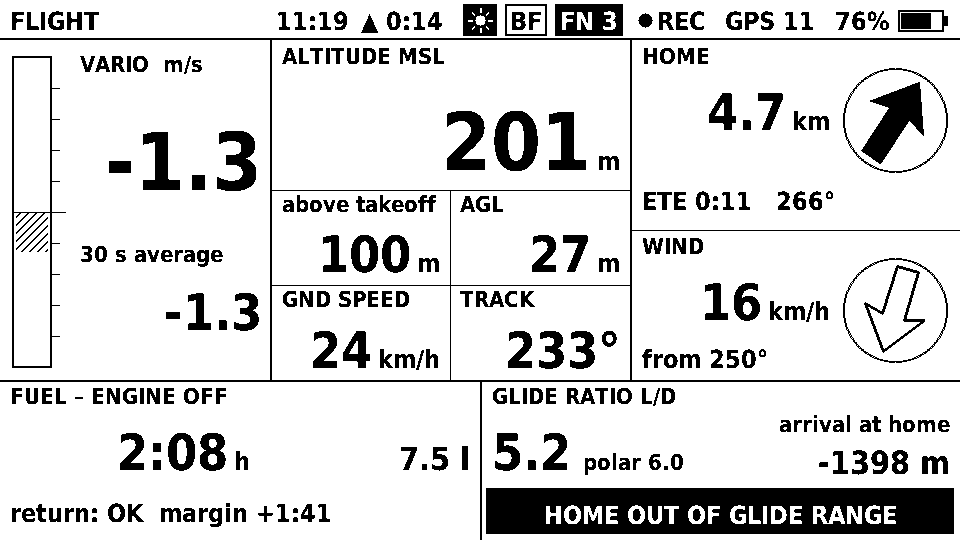 | 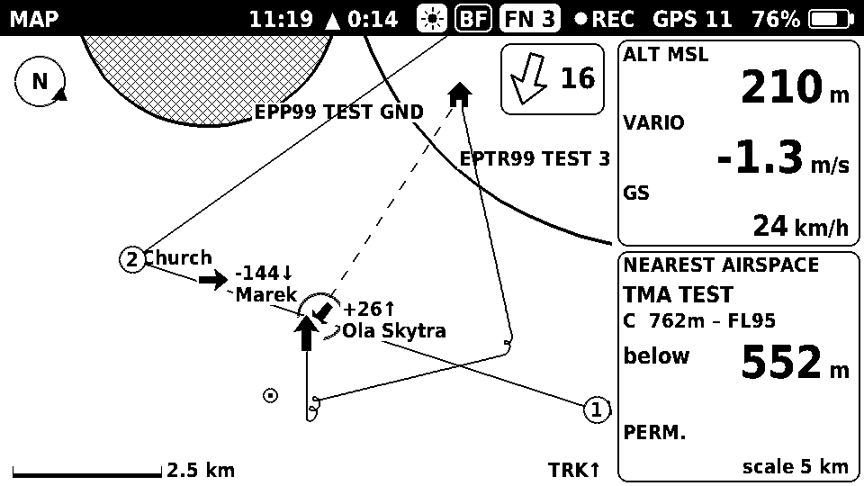 |

**In flight it shows:**
* **altitude and vario** – from a wired barometer or a BlueFlyVario over Bluetooth (without a barometer: from GPS); height above takeoff and above the terrain, average climb, thermal gain,
* **wind** – worked out on its own from a few turns, no extra sensors,
* **fuel** – flight time left, fuel needed to get home against the wind plus reserve, and a **TURN BACK** alert when it no longer suffices,
* **home and glide** – direction and distance to takeoff (Go Home), glide ratio, whether home is within glide with the engine off,
* **navigation** – to takeoff, a waypoint, the nearest landing field, or along a route with automatic point switching,
* **airspace** – zones on the map, the nearest zone, time to entry, the vertical profile ahead and alerts; time-limited zones follow the AUP activation file,
* **airspace exit** – if you fly into active airspace by mistake, one button shows the fastest way out (level, up or down),
* **topographic map** (TOPO screen) – forests, water, built-up areas, power lines, wind turbines, masts, aerodromes,
* **other pilots (FANET)** – the 868 MHz radio on the board: you see FANET-equipped pilots and get proximity warnings, and they see you.

**Before and after the flight:**
* **plan routes on the phone** (Android app, OpenTopoMap with airspace) and send them over Bluetooth – ParaNav checks right away whether the route crosses airspace,
* **airspace, waypoints and maps** come from the phone, a card reader or a USB cable (the card as a drive on a computer),
* **IGC and GPX logging** starts and stops by itself; a flight summary after landing,
* **charging** – when USB is plugged in the device asks: navigation, charging or files.

**Hardware:** LilyGO T5 E-Paper S3 Pro (ESP32-S3, 4.7″ 960×540 screen, GPS, LoRa radio, battery) + an inexpensive MS5611 barometer or a BlueFlyVario. English or Polish user interface, built-in help in the menu.

## Features in detail (version 0.5.8)

Changes between versions: [Version history](#version-history).

| Area | What works |
|---|---|
| Altitude | barometric (QNH, auto-calibration from GPS or terrain data), height above takeoff, AGL (SRTM terrain) |
| Variometer | Kalman filter at ~90 Hz, 30 s average, circling detection and thermal gain (visual only – no buzzer) |
| Wind | circle fit to GPS velocity vectors during turns (≥200° within 90 s) |
| Glide | measured L/D (GS / sink) in a steady glide, glide range from the polar + wind, "home within glide" |
| Fuel | endurance, fuel to get home (wind corrected) + reserve, TURN BACK alert, counter stops with the engine off |
| Airspace | OpenAir from SD, lateral and vertical check, predicted time to entry, AUP activation file, vertical profile |
| Airspace exit | INSIDE alert with **LEAD ME OUT / IGNORE** buttons; EXIT screen with the fastest way out (level / up / down) |
| Route check | after a route is chosen (on the device or from the phone): list of zones it crosses; the app warns before sending too |
| Navigation | Go Home, waypoint from a list, nearest landing field, several routes (.cup) with a "Choose route" list, route drawn on MAP and TOPO, automatic point switching, ETE/ETA, required L/D |
| Flight log | IGC + GPX in `/logs`, automatic start/stop (takeoff detection, LANDED? question), flight summary |
| TOPO map | black and white topographic map from OpenStreetMap (water, forest, built-up areas, power lines, wind turbines, masts, aerodromes, roads), north up, z10–z14 |
| FANET | on-board 868 MHz LoRa radio: position broadcast (as a paraglider), other pilots on MAP, TOPO and the TRAFFIC screen, proximity warnings, visibility in OGN |
| Language | English / Polish – Menu → Display and map → Language / Język (stored in `config.ini`: `lang=en` / `lang=pl`) |
| Data upload | SD card in a card reader, **USB mode** (the card as a drive on a computer), phone via Bluetooth (airspace, waypoints, routes) |
| Route planning | in the Android app on an OpenTopoMap map with airspace and waypoints, sent to ParaNav as the active route |
| System | battery (BQ27220), GPS status, SD card, FANET, free memory |

## Hardware

### Connecting the MS5611
QWIIC connector (JST-SH 4 pin): **black = GND, red = 3V3, blue = SDA (GPIO39), yellow = SCL (GPIO40)**.
GY-63 module: VCC→3V3, GND→GND, SCL→SCL, SDA→SDA, leave PS as is (pulled up to VCC on the module = I²C mode).
Address 0x77 (CSB=0) or 0x76 – both are detected automatically.

Mounting tips: the sensor is **sensitive to light** – cover it with a piece of foam, keep it out of the propeller airflow, and give the enclosure a small hole for static pressure.

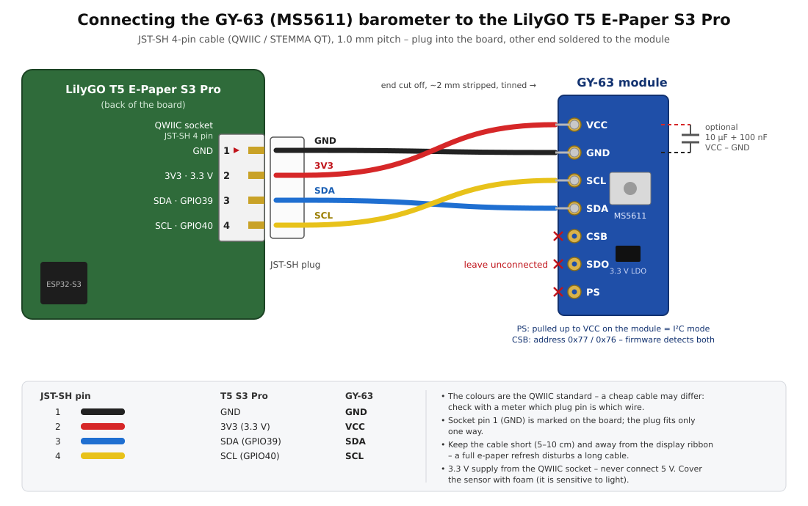

#### JST-SH cable soldered to the GY-63 – step by step
You need a **JST-SH 4-pin, 1.0 mm pitch** cable (sold as QWIIC / STEMMA QT) – with a plug on one end, or a double-ended one cut in half. 5–10 cm is enough.

1. **Check the colours with a meter.** QWIIC standard: pin 1 = black GND, pin 2 = red 3V3, pin 3 = blue SDA, pin 4 = yellow SCL. Cheap cables may use other colours – the plug pin counts, not the colour. Socket pin 1 is marked on the board.
2. **Prepare the end:** cut it, strip ~2 mm of each wire, twist and tin it. Slide heat-shrink tubing onto the wires.
3. **Solder to the GY-63 pads:**

   | JST-SH | colour | T5 S3 Pro | GY-63 |
   |---|---|---|---|
   | 1 | black | GND | **GND** |
   | 2 | red | 3V3 | **VCC** |
   | 3 | blue | SDA (GPIO39) | **SDA** |
   | 4 | yellow | SCL (GPIO40) | **SCL** |

   **Leave CSB, SDO and PS unconnected.** PS is pulled up to VCC on the module (I²C mode), CSB selects address 0x77/0x76 – the firmware probes both. The pad order may differ between module batches: follow the silkscreen, not the position in the drawing.
4. **Optionally** solder 10 µF and 100 nF capacitors between VCC and GND, as close to the sensor as possible – they reduce interference from full e-paper refreshes.
5. **Secure it:** shrink the tubing and fix the cable at the module with a drop of hot glue (strain relief against engine vibration).
6. **Plug it** into the QWIIC socket and power on. The boot screen should show `[OK] Wired barometer MS5611 (address 0x77)` (or 0x76), and the SYSTEM screen "Barometer: wired …" and 77/76 in the I²C list. The sensor can also be plugged in while running – it is probed every 10 s.

Power is **3.3 V from the QWIIC socket – never 5 V**. Keep the cable short and away from the display ribbon.

### Back cover with a barometer compartment (3D print)
Print file: [`hardware/Lilygo_T5_cover_for_baro.stl`](hardware/Lilygo_T5_cover_for_baro.stl) – a back cover for the LilyGO T5 E-Paper S3 Pro, fitted to the **GY-63** module.

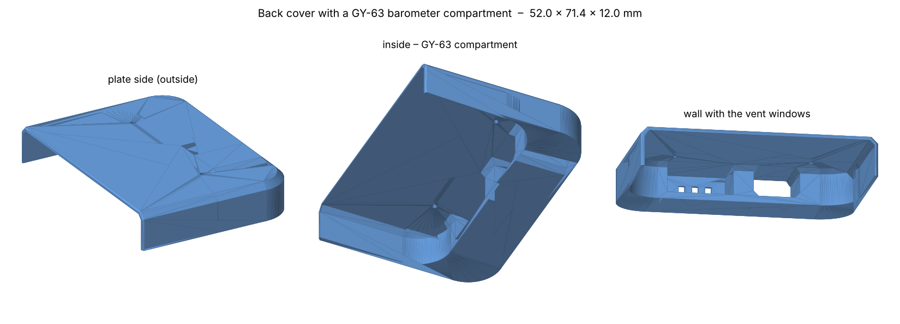

* size about **52 × 71.4 × 12 mm**, 1 mm plate,
* a **compartment for the GY-63 module** inside; the side wall of the compartment has **three small windows** – the sensor measures ambient pressure, so do not cover them – and a larger rectangular opening,
* two Ø 1.5 mm holes in the plate (about 41 mm apart).

Printing tips: print it **plate down** (rotate the model 180° in the slicer) and check in the slicer preview whether the inner ledges of the compartment need supports. PETG/ASA survive cockpit sun better than PLA. Cover the module with a thin piece of foam (light disturbs the MS5611) without blocking the windows.

### Barometer: wired, BlueFly or none
One firmware handles three cases automatically – the source is chosen continuously:
1. **MS5611 on the QWIIC cable** – if it responds (checked every 10 s, can be plugged in after power-on),
2. **BlueFlyVario v25 via Bluetooth LE** – the device looks for "BlueFly…" (Microchip Transparent UART service), connects and reconnects after a lost link. Supported BlueFly output formats: `PRS`/`_PRS` (default), `LK8EX1`, `LXWP0`, `$XCTOD` (battery). The BlueFly GPS position is ignored – the internal GPS is used,
3. **no barometer** – altitude and vario from GPS (less accurate, vario lags a few seconds).

Changing the source restarts the vario filter (no false jump), and losing the barometer in flight raises the NO BAROMETER alert. Bluetooth can be switched off in Menu → System (saves battery). Note: a BlueFly connected to ParaNav cannot connect to a phone at the same time.

**Wired sensor and full screen refreshes (0.5.2):** the e-paper high-voltage supply disturbs the wired MS5611 during a full refresh (about 2 m altitude jump, ±0.5 m/s on the vario). For the refresh and 1 s after it the vario ignores the wired readings and extrapolates with the last climb rate; isolated samples more than 1.5 m off the prediction are rejected as well (a jump that lasts 0.3 s is accepted as real). The SYSTEM screen shows `F a/b` next to the pressure: refreshes waited out / samples rejected. Hardware help: 10 µF + 100 nF across VCC–GND at the sensor, a short cable routed away from the display flex.

<p align="center">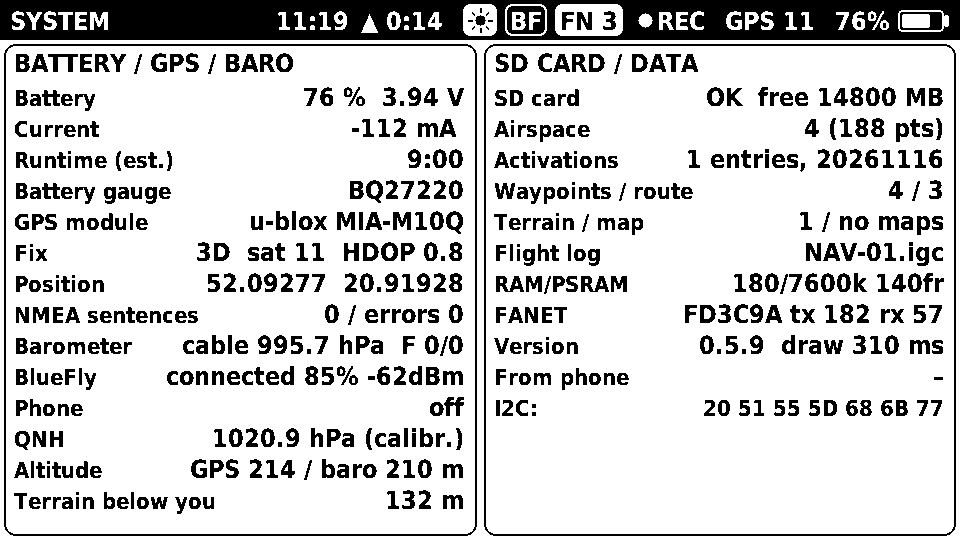<br><sub>SYSTEM screen – barometer (F a/b), memory (RAM/PSRAM, “fr”) and redraw time (“draw”)</sub></p>

### Buttons
On the schematic IO48 is a display line; the user button **S3 is connected through the PCA9535 expander (IO1_2)**. The second button is **BOOT (GPIO0)**.

| | Short | Long (>0.7 s) |
|---|---|---|
| **KEY (S3)** | next screen / menu: next / editing: + | open menu / select / save |
| **BOOT** | previous screen / menu: back / editing: − | **Go Home** (target = home, NAV screen) / exit menu |
| any | acknowledges the active alert | |
| **both together** | short (<1 s) = **front light on/off** | 3 s = **power off** (works in the menu too) |

**Front light:** press both buttons briefly at the same time (or Menu → Display and map → Front light). While it is on, the status bar shows a black box with a sun – in bright sunlight you can see immediately that it is draining the battery. Brightness and automatic switch-off after N minutes are in the same menu. The PWR button cannot be used for this: it is wired only to the charger chip (QON input of the BQ25896), not to the processor, so the software cannot see it.

**Power on / off:** the PWR button on the board or plugging in USB powers the device on. Power off: **hold both buttons (KEY + BOOT) for 3 s** (POWERING OFF… appears after 1 s, releasing cancels) or Menu → *Power off* → *YES*. The flight is saved and closed, and POWERED OFF stays on the screen. The BQ25896 charger then disconnects the battery. **Power off does not work while USB is connected** – that is how the charger chip works, not the firmware.

| Both buttons held – powering off | Powered off |
|:---:|:---:|
| 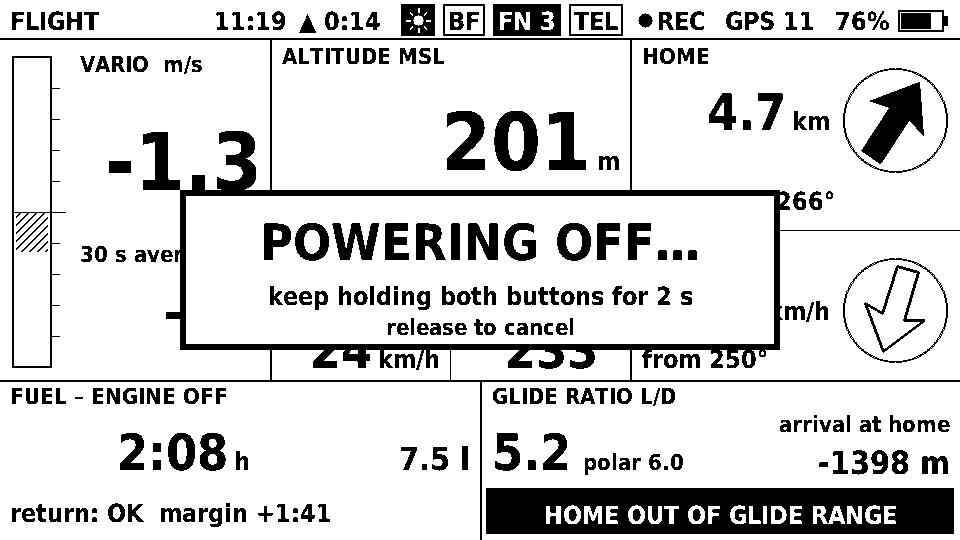 | 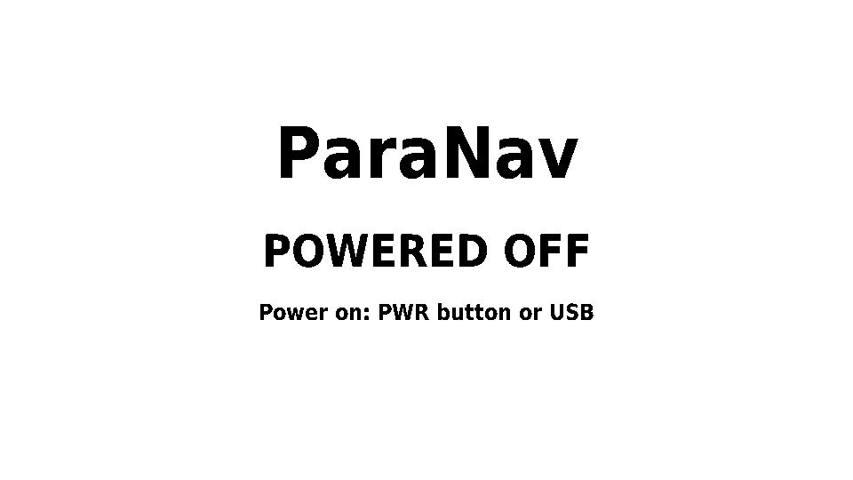 |

Touch (bare fingers): top bar = menu, left edge = previous screen, right edge = next, MAP centre = change scale, TOPO upper/lower half = zoom in/out, TRAFFIC list = fly to the pilot, NAV = change target, FUEL = ±0.5 l / full tank / engine buttons. In the menu: tap an item to choose it; long lists have big **▲ / ▼** buttons on the right (page up / down).

**Menu refresh:** the menu, help and the flight summary are static – they are redrawn only after a button press or a touch (no updates every second, no timed full refresh). A full refresh (flash) happens when the menu opens or closes and after every 20 moves inside it, so no ghosting builds up.

| Menu | Editing a value in the menu |
|:---:|:---:|
| 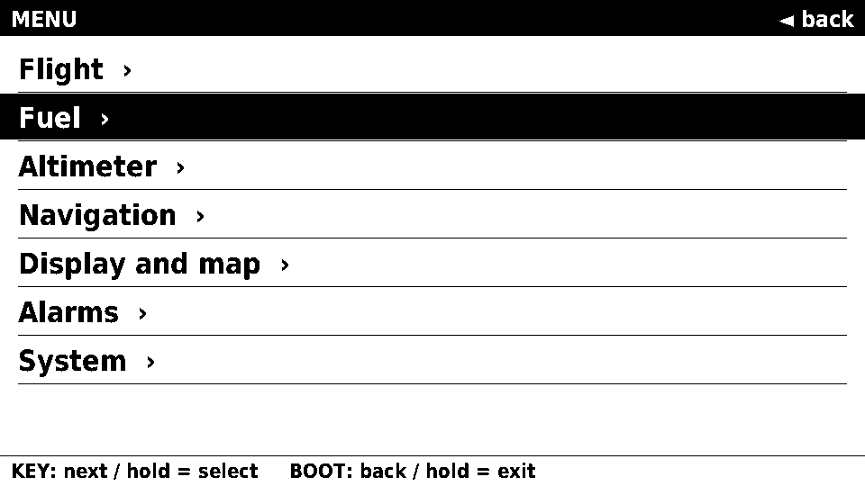 | 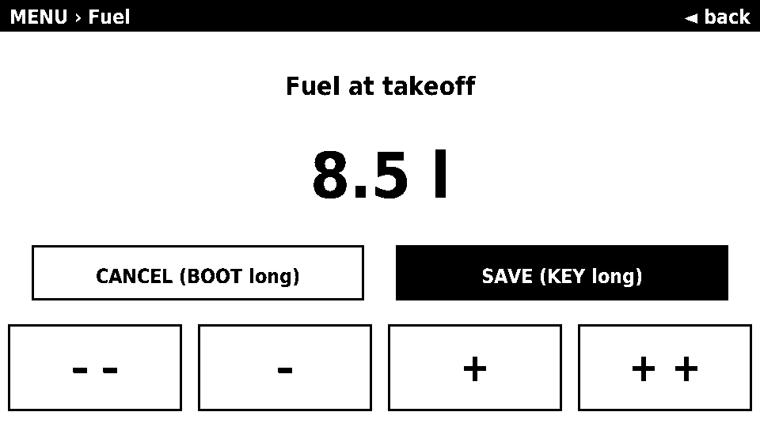 |

### USB power: navigation, charging or files
When USB power appears, ParaNav asks what to do (like action cameras): **NAVIGATION** (normal operation, e.g. a power bank in flight), **CHARGING** (static battery screen: navigation paused, FANET and BlueFly off, redrawn only when the percentage changes) or **FILES** (USB mode – offered only when a computer is on the other end of the cable). Tap a button, or KEY short = next / long = choose.

* No answer within 15 s: **charging** if the device was switched on by plugging USB in, **navigation** if it was already running.
* **Never asked in flight** – a power bank plugged in during the flight just powers the device. After a crash restart (watchdog, panic, brownout) the device goes straight back to navigation.
* Leaving charging: tap the screen, hold KEY, or **unplug USB** → navigation starts. Manual: Menu → System → *Charging mode*.

| Question after plugging in USB | Charging mode |
|:---:|:---:|
| 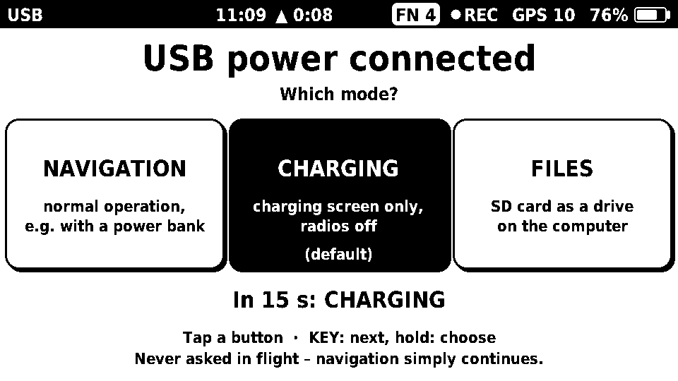 | 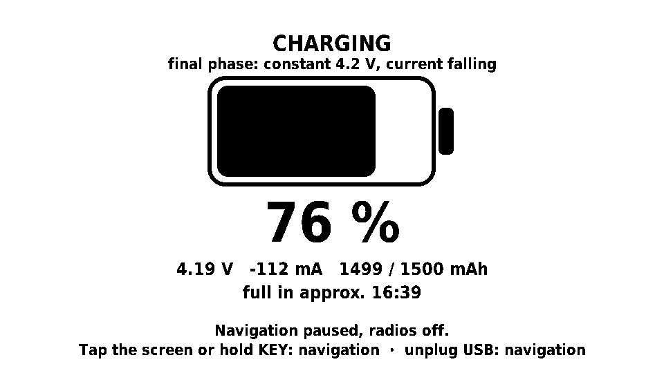 |

### Landing question
The flight no longer ends by itself after a minute without movement – flying into a strong wind you can "hang" in one place for a long time. After **60 s without movement** (below 5 km/h and vario within ±0.5 m/s) the **LANDED?** question appears:
* **STILL FLYING** (KEY short or the left button) – the question disappears and does not come back for 5 min,
* **LANDED** (BOOT short or the right button) – the log is closed and the flight summary is shown.

Without an answer the flight goes on. If you still do not move, the flight ends by itself **4 min** after the question appeared (countdown in the bottom line); moving again (above 8 km/h or vario beyond ±1 m/s) closes the question. When you are **higher than 50 m above the terrain** (needs terrain files) there is no question. The flight time in the summary ends when you stopped, not when you answered.

<p align="center">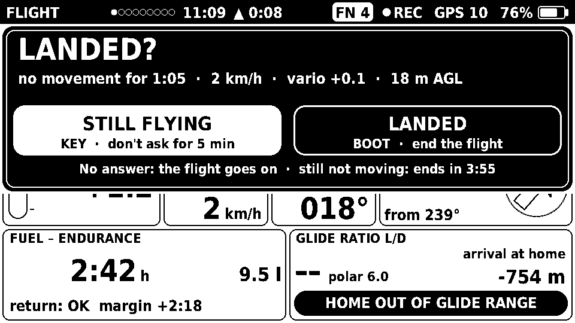<br><sub>LANDED? question on the FLIGHT screen</sub></p>

### Airspace exit and route check
When you enter active airspace (the zones that raise the INSIDE alert – ignored classes and zones inactive according to the AUP file do not count), the alert has two buttons:
* **LEAD ME OUT** (KEY short or the left button) – the **EXIT** screen with the fastest way out, regardless of the target, the route or Go Home,
* **IGNORE** (BOOT short or the right button) – the alert returns after 2 min if you are still inside.

Three ways are compared and the fastest one is shown:
* **level** – directions every 5°; for each, the distance to free airspace (through neighbouring zones, + 150 m margin); time = turn (12°/s) + flight at max(GS, cruise speed),
* **up** – above the ceiling of every zone above you (including a zone stacked on top) + 30 m, at the climb rate from Menu → Alarms (default 1.5 m/s),
* **down** – below the floor − 30 m at the sink rate from Menu → Alarms (default 2 m/s); not offered when the zone starts at the ground or it would take you lower than 60 m above the terrain.

Screen: an arrow relative to your track (or a big CLIMB / DESCEND arrow with the target altitude), the zone name and the times of all three options. The plan is recomputed every second; the screen closes 10 s after you are out (by hand: hold KEY). Without the alert: Menu → Navigation → *Lead me out of airspace*.

| INSIDE alert | EXIT – horizontal | EXIT – climb |
|:---:|:---:|:---:|
| 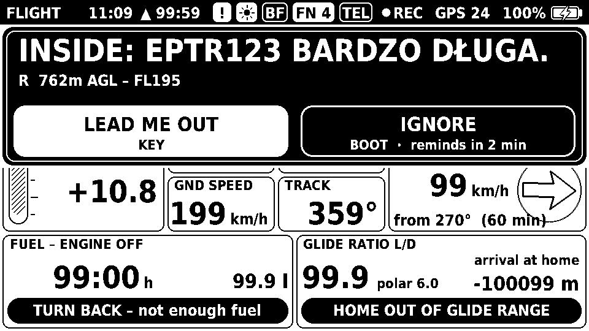 | 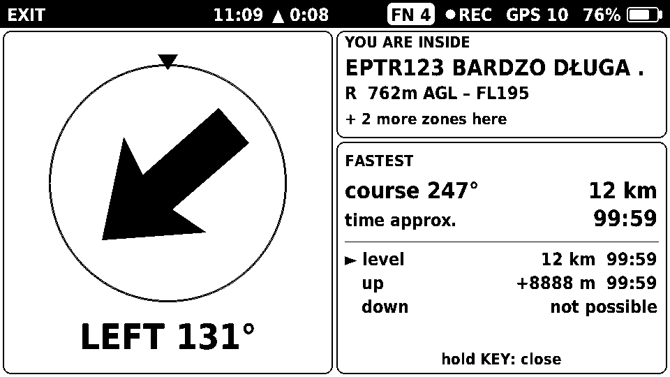 | 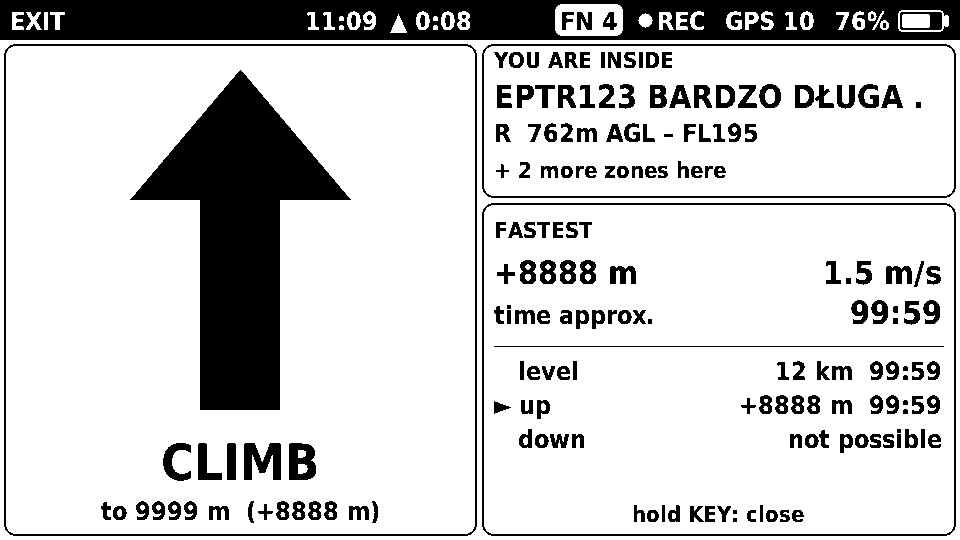 |

**Route check:** after choosing a route in Menu → Navigation → Choose route, or activating it from the phone, ParaNav checks which zones the route crosses (a sample every 100 m), using the terrain below the route and today's activation schedule. A conflict = a zone not known to be inactive with its floor below the height in Menu → Alarms → *Route check: flying up to* (default 1000 m AGL). The list is shown on the screen; the app receives the number of conflicts and shows it. The app also checks the route itself before sending (against the zones loaded on its map, without terrain and AUP – more cautious). Again: Menu → Navigation → *Check route – airspace*.

<p align="center">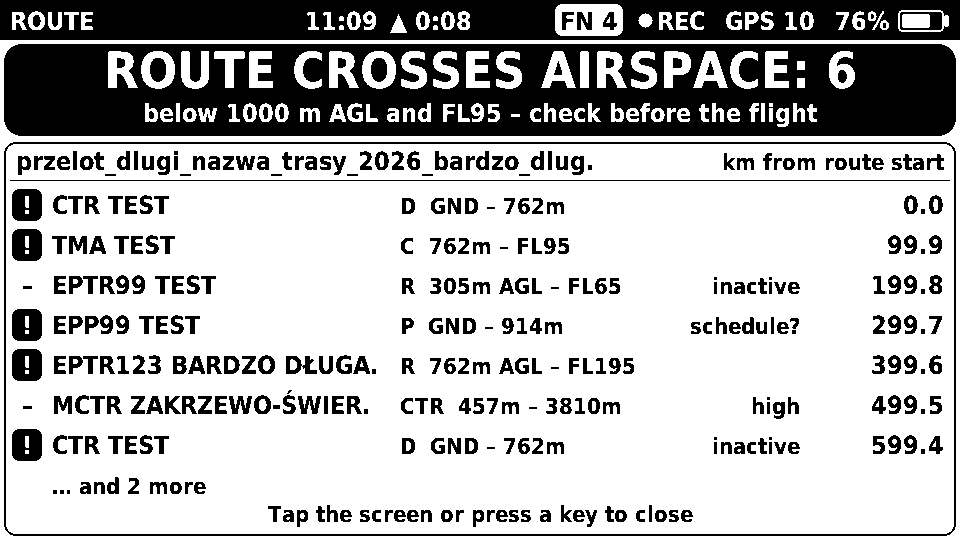<br><sub>Route check – zones crossed by the route</sub></p>

## Built-in help
Menu → **Help**: buttons and touch, status bar, every screen, FANET, alerts, files on the SD card, maps and USB mode, automatic takeoff/landing/logging. The text is in `lib/navcore/src/ui/help.cpp` (Polish and English side by side); `tools/preview/layout_check.sh` checks in both languages that every page fits on the screen and that the font has all characters.

## Screens

`FLIGHT → MAP → TOPO → TRAFFIC → NAV → THERMAL → AIRSPACE → FUEL → SYSTEM` (switching: KEY / BOOT short or a touch on the left / right edge). The pictures below come from the `tools/preview/build.sh` preview – the same drawing code as on the device, a simulated flight with the sample data from `sd_card/`; TOPO is shown without a background map.

| FLIGHT | MAP | TOPO (no background map) |
|:---:|:---:|:---:|
|  |  | 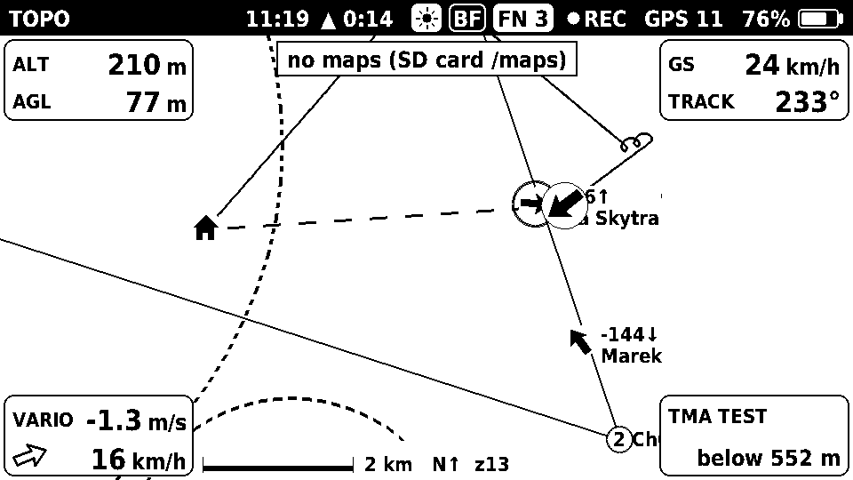 |

| TRAFFIC (FANET) | NAV | THERMAL |
|:---:|:---:|:---:|
| 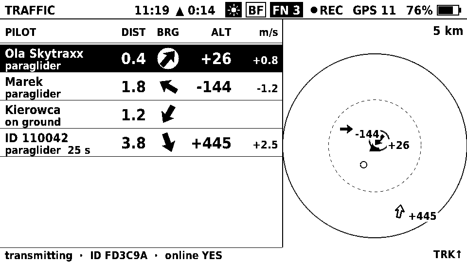 | 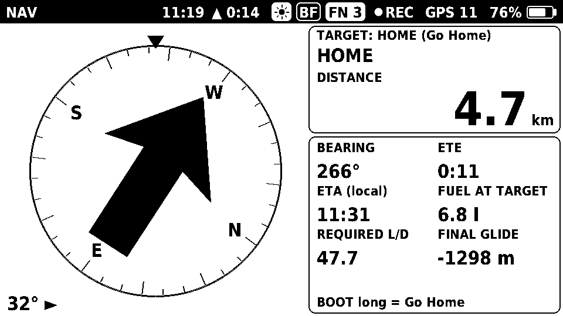 | 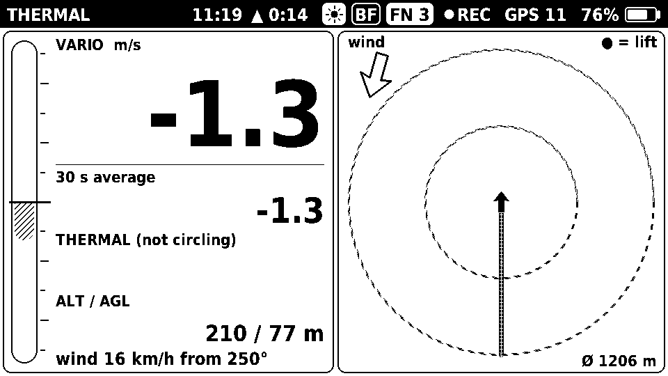 |

| AIRSPACE | FUEL | SYSTEM |
|:---:|:---:|:---:|
| 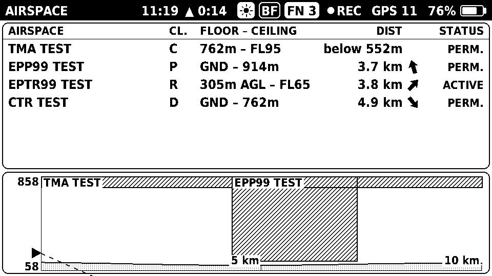 | 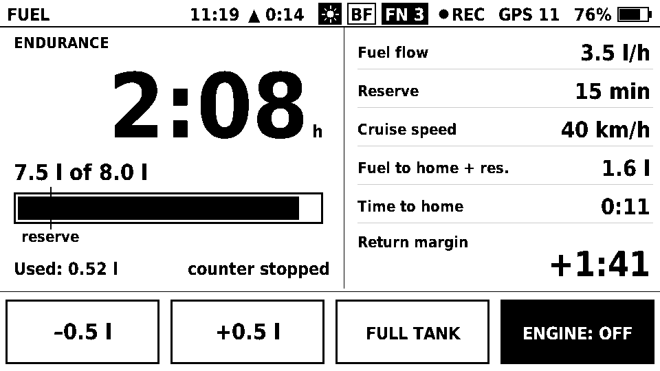 |  |

| Flight summary | Boot screen | Menu |
|:---:|:---:|:---:|
| 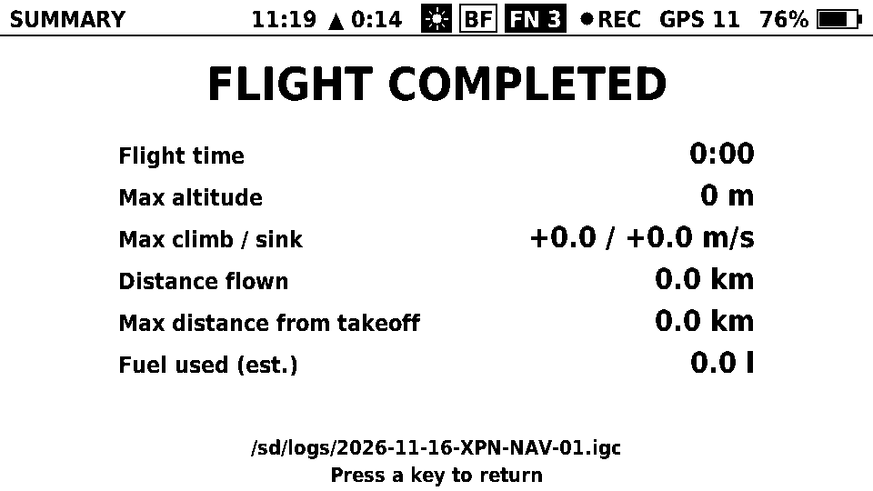 | 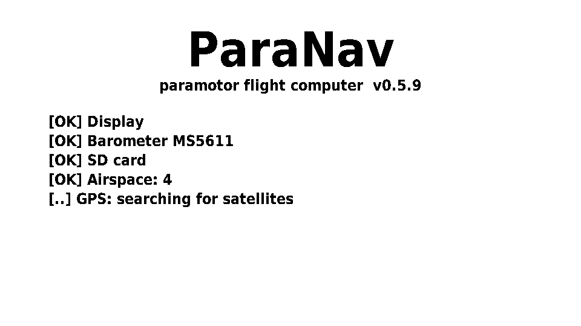 |  |

Look (0.5.3): content is grouped in rounded "cards" (2 px frame, 6 px gaps), the status bar is black like the menu title, warnings are rounded black bars, touch buttons have a small shadow, and the vario bar is a rounded scale with a bold zero line. Everything is pure black and white – grey does not survive the fast (DU) e-paper refresh. Drawing helpers: `Canvas::roundRect / fillRoundRect / invertRoundRect`, `card()` and `pill()` in `screens.cpp`.

### Airspace on the map
Airspace interiors are hatched, not grey. The fast e-paper refresh (every second) supports black and white only, so grey would "float" between refreshes.

* **dense cross-hatch** – prohibited, restricted and danger areas (P, R, Q, EPP/EPR/EPD),
* **diagonal lines every 10 px** – CTR and TRA/TSA (EPTR/EPTS),
* **sparse diagonal lines** – others (TMA, ATZ, class C/D...).

Only active airspace relevant at your altitude is hatched: you are within its vertical limits or closer than 2× the vertical buffer (min. 150 m). Airspace far above or below you has an outline only, inactive airspace a dashed outline.

| Airspace on the MAP | AIRSPACE screen with the vertical profile |
|:---:|:---:|
|  |  |

## Routes: planning and choosing

* **Planning – Android app** → "Plan a new route on the map" / "My routes". OpenTopoMap map (topographic), the airspace and waypoints you sent to ParaNav (or added in the planner menu) are shown on it. Tap the map = add a point (tapping a known waypoint uses its name and elevation), tap a point = name / landing field / insert before / delete, hold and drag = move, ↶ = undo, ⤢ = whole route. Below the map: legs with distance and course, total length and time at your cruise speed. Routes are saved on the phone automatically; they can be exported/imported as `.cup`.
* **Sending:** "Send to ParaNav" adds the route next to the existing ones (option: delete the others) and can make it the **active route** right away (firmware 0.5+).
* **On ParaNav:** Menu → Navigation → **Choose route** – all routes on the card with points and length (● = active); the choice is remembered in `config.ini` (`routeFile`). The active route is drawn on MAP and TOPO: a line with numbered circles, square = landing field, black = the point you are flying to.
* **Elevation:** points planned on the map have no elevation in the `.cup` file; ParaNav takes it from the terrain data (`/terrain`). Without terrain data the final glide to such a point shows "––" instead of a wrong value.

Map tiles: © OpenStreetMap contributors, SRTM | map style © OpenTopoMap (CC-BY-SA). The app downloads only what is shown on the screen and keeps it in its cache (works offline for areas viewed before); bulk download is not allowed by the tile server.

## Uploading files from a phone (Android)
The app in `android/` (build instructions: `android/README.md`) sends airspace (OpenAir), today's activations, waypoints and routes (.cup) via Bluetooth – without removing the SD card. ParaNav checks every file before saving and loads it immediately; during the upload a progress bar is shown at the bottom of the screen and "TEL" in the status bar. On/off: Menu → System → Phone (Bluetooth). The app is in English, or in Polish when the phone is set to Polish.

| Receiving a file from the phone | SYSTEM screen – result from the phone |
|:---:|:---:|
| 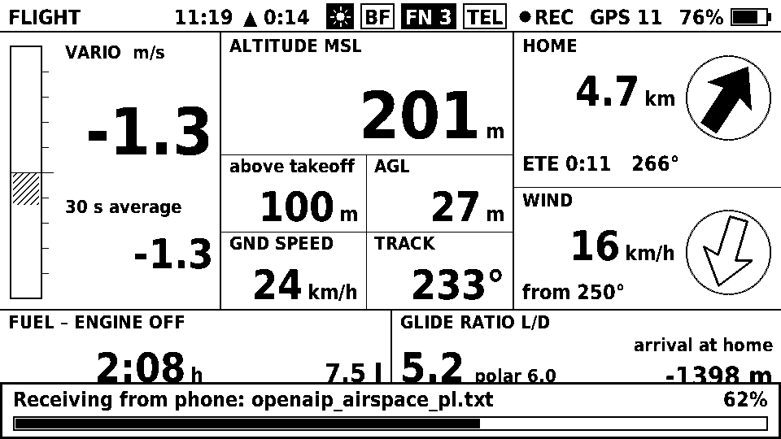 | 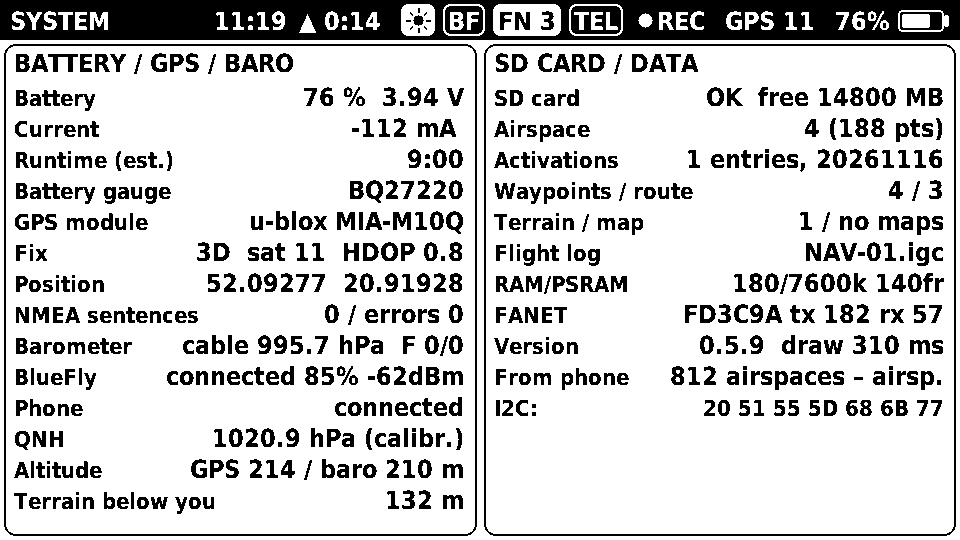 |

## SD card (FAT32)

```
/config.ini                 settings (created/updated by the device)
/airspace/*.txt             airspace in OpenAir format (all .txt files are loaded)
/airspace/activations.txt   today's airspace activations (format below)
/waypoints/*.cup            waypoints (SeeYou .cup); style 2–5 = landing field
/route/*.cup                route – order of the points in the file = order of the route
/terrain/N52E021.hgt ...    SRTM terrain data (.hgt, 3″ or 1″)
/maps/<area>/info.txt       base map for the TOPO screen (+ z10.pak … z14.pak)
/logs/                      recorded flights .igc + .gpx
```
Example (fictional!) files are in `sd_card/`.

### Where to get the data
* **Airspace (OpenAir)**: [openAIP](https://www.openaip.net) – export your country in OpenAir format; for Poland also the file by Ryszard Lewandowski at lotnik.org (link at [soaringweb.org/SUA/PL](https://soaringweb.org/SUA/PL)). Update every AIRAC cycle (28 days).
* **Activations (AUP/UUP)**: TRA/TSA/EPR/EPD/MRT areas are activated daily. For now you type them into `activations.txt` (in Poland e.g. from the "AUP w Polsce" app or the PANSA website) or in the Android app. Without this file such areas have the status "ACT.?" and are treated as active (the safer choice).
  ```
  date=2026-11-16
  EPTR12 0800-1500
  EPTS05 0900-1100 1300-1600
  ```
  Times in **UTC**; the name matches the beginning of the airspace name (`EPTR12` matches "EPTR12 KRZESINY" but not "EPTR121").
* **Terrain**: SRTM `.hgt` tiles in `/terrain` (see "Terrain data" below).
* **Waypoints**: any .cup editor (SeeYou, XCSoar, WeGlide).

## Terrain data (.hgt)

Terrain gives you: height **above ground (AGL)**, automatic QNH, the vertical profile on the AIRSPACE screen and glide range over the ground. Without it these fields show "––" and everything else works.

**Where from:**
1. **viewfinderpanoramas.org** (recommended – SRTM with voids filled): page [dem3.html](https://viewfinderpanoramas.org/dem3.html) → 3″ coverage map → click the sheets you need. The 1:1M world map sheets over Poland are **M33, M34** (48–52°N) and **N33, N34** (52–56°N), the eastern edge of Poland is in **M35/N35**. Each ZIP contains dozens of tiles.
2. **NASA Earthdata**, SRTMGL3 collection (free account required): files `N52E021.SRTMGL3.hgt.zip` – unzipped `N52E021.hgt`.

**Where to:** into the **`/terrain`** folder on the SD card. Tiles may be directly there or in subfolders, e.g. as unzipped: `/terrain/M34/N52E021.hgt`. Letter case does not matter.

**Which ones:** the tile name is its south-west corner, e.g. `N52E021.hgt` = 52–53°N, 21–22°E. All of Poland is N49–N54 × E014–E024 (~60 tiles with land, about 170 MB at 3″). The tiles around the places where you fly are enough. Both 3″ (2.9 MB/tile) and 1″ (26 MB/tile; more detailed but slower from the card) are supported.

**Check:** SYSTEM screen → "Terrain / map" (first number = terrain tiles found) and "Terrain below you" (terrain elevation at your position, after a GPS fix).

## Base maps (TOPO screen)

The **TOPO** screen (after MAP) shows a topographic map designed for e-paper: black and white, with bold symbols for whatever is dangerous to a pilot.

| Symbol | Meaning |
|---|---|
| horizontal lines, solid shore | water, sea |
| dots | forest |
| cross-hatch | built-up area (housing, industry) |
| line with cross ticks and dots | high-voltage power line (thin, no dots – medium voltage, from z12) |
| tripod in a circle | wind turbine (from z13 with height, if known in OSM) |
| caret with a dot | mast, tower, chimney |
| circle with a horizontal bar | aerodrome / airstrip (`aeroway=aerodrome/airstrip`), runways from z12 |
| black lines | roads (width = road class) |
| double line | river; black and white line – railway |

Overlays: your position and track, flight track, HOME, line to the target, waypoints and landing fields from `.cup`, other pilots (FANET) and **airspace outlines only** (details on the AIRSPACE screen and in the alerts). Corners: altitude/AGL, ground speed/track, vario/wind, nearest airspace. Tap the upper half of the map to zoom in, the lower half to zoom out (z10 ≈ 90 km screen width, z14 ≈ 6 km). The map moves in steps (when you are about 1/3 of the screen away from the centre) so that the e-paper does not redraw everything every second.

**The far view (z10–z11) is simplified** – so the e-paper shows obstacles rather than "noise" from hundreds of small woods:
* **no forest**,
* **towns only** – neighbouring built-up patches are merged, villages are dropped; a town is an outline with a sparse hatch,
* water as usual, **roads:** z10 motorways and expressways, z11 also primary roads; no railways,
* **power lines from 220 kV** (a line without a voltage in OSM is drawn too), ticks every 60 px,
* **a wind farm = one symbol with the number of turbines** (e.g. "×28"); single turbines and pairs stay as dots,
* **masts, towers and chimneys** only with an OSM height of at least 100 m (no cranes); rivers without canals, no small ponds.

At **z12** masts, towers and chimneys are shown from 40 m (telecom towers and flares always) and clusters as one symbol with a count; cranes appear only at z14. From z13 on the map shows everything as in the table above (except cranes). This is a generator change – regenerate the map to see it.

> The OSM-based map is an orientation aid, **not an aeronautical chart** – power lines and obstacles may be incomplete.

### 1. Making the map

Data: [Geofabrik](https://download.geofabrik.de/) (OpenStreetMap, ODbL licence – downloading for offline use is allowed). Tool: `tools/topo/make_tiles.py`.

**Option A – on GitHub, nothing to install (recommended):**
1. The project in your own GitHub repository (the same one that builds the APK).
2. **Actions → "Build map" → Run workflow.** Defaults: Gdańsk, radius 100 km, levels 10–14, the Geofabrik files for pomorskie + kujawsko-pomorskie + warmińsko-mazurskie + Kaliningrad oblast (so that the coastline of the Vistula Lagoon and Spit is continuous).
3. After about 10–30 min: open the finished run → download the **mapa-gdansk** artifact (zip) → unzip. Inside: the `maps` folder and `preview_*.png` previews.

Other area: change the name, centre, radius and the list of Geofabrik files (together they must cover the whole circle – e.g. for Warsaw `europe/poland/mazowieckie`, for the Alps e.g. `europe/austria`). A whole country at levels 10–12 is fine; levels 13–14 are best limited to your home area.

**Option B – on your own computer** (Python 3.9+):
```
pip install -r tools/topo/requirements.txt
python3 tools/topo/make_tiles.py --pbf pomorskie-latest.osm.pbf --pbf kujawsko-pomorskie-latest.osm.pbf \
   --pbf warminsko-mazurskie-latest.osm.pbf --pbf kaliningrad-latest.osm.pbf \
   --name gdansk --title "Gdańsk 100 km" --center 54.35,18.65 --radius-km 100 --zooms 10-14 --out out --preview
```

Size: Gdańsk 100 km, z10–z14 – roughly 20–60 MB (sea and solid forest take almost nothing – identical tiles are stored once).

### 2. Putting it on the card

* **Card reader:** copy the `maps` folder to the root of the card.
* **USB mode (without removing the card):** Menu → System → **USB mode – SD card as a drive**, connect USB-C to a computer. The card appears as a "ParaNav" drive. Copy `maps`, then **eject the drive on the computer** – ParaNav returns to normal operation and reloads everything (or KEY/BOOT long). Works for airspace, waypoints, terrain and flights too (`/logs` – download your IGC files). USB mode is not available in flight; the flight log is closed. When the mode starts, the device briefly disconnects from the computer and connects again (0.5.6) so the computer notices the "inserted card" and shows the drive; FANET and BlueFly are off meanwhile.

Several areas on the card (e.g. `maps/gdansk`, `maps/holiday`) – the device picks the one covering your position. SYSTEM → "Terrain / map" shows the terrain tiles and the name of the active map.

<p align="center">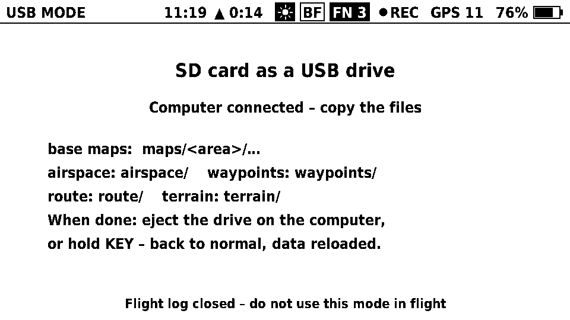<br><sub>USB mode – SD card as a drive</sub></p>

## FANET – other pilots (LoRa 868 MHz)

The on-board SX1262 module speaks the open **FANET** protocol (868.2 MHz, LoRa SF7/250 kHz, [specification](https://github.com/3s1d/fanet-stm32/blob/master/Src/fanet/radio/protocol.txt)) – the one used by Skytraxx, XC Tracer, Naviter (FANET+), Burnair, Leaf, GXAirCom, SoftRF. **FLARM is not supported** (closed, encrypted protocol) – aircraft and gliders with FLARM only do not see ParaNav, and ParaNav does not see them.

* **Transmitting:** position, GPS altitude, ground speed, climb rate and track every 5 s (in the air a "tracking" packet, aircraft type *paraglider*; on the ground "ground tracking"), the pilot name every 4 min – set it in `config.ini` as `pilot=First Last` (sent without accents; with the default "Pilot" no name is sent). Address: `FD` + a random 16-bit number stored in `config.ini` (`fanetId`) – shown on the SYSTEM and TRAFFIC screens.
* **Visible online** (default YES): the "online tracking" bit – [OGN](https://www.glidernet.org) ground stations may show your position on the internet. Menu → FANET → Visible online.
* **Display:** MAP and TOPO – arrows with height difference; **TRAFFIC** screen – list and track-up radar, tapping a pilot makes him the navigation target; status bar **FN n**.
* **Warnings** (in flight only): closest point of approach predicted 60 s ahead, assuming constant tracks and speeds. *Caution* (TRAFFIC box in the top right of any screen): closer than the distance limit (default 300 m) and height limit (100 m), or such an approach predicted within 45 s. *Alarm* (TRAFFIC! bar with the clock position): half the limits or within 20 s. Limits and on/off: Menu → FANET.
* **Internal antenna** – the range depends on where the device sits (cage metal, the pilot's body). Check on the ground with a friend, or on glidernet.org, that your position gets through.

| TRAFFIC screen – list and radar | Traffic caution on another screen |
|:---:|:---:|
|  | 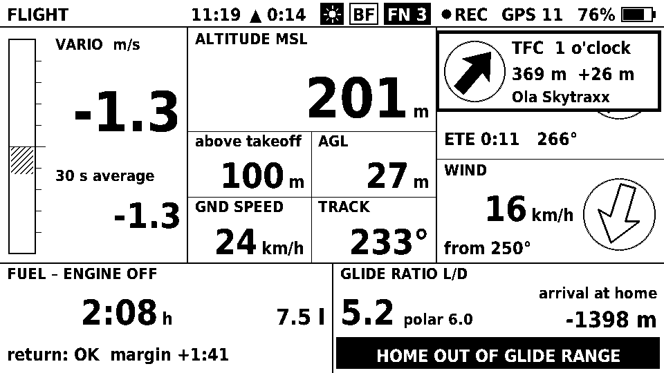 |

> FANET is an aid to lookout, not a collision avoidance system: positions arrive every ~5 s and not everyone carries a transmitter. Keep a lookout.

## Building

1. Install [PlatformIO](https://platformio.org) (VS Code + extension or `pip install platformio`).
2. `pio run -t upload` in the project folder. If the board does not enter programming mode: hold BOOT, press RST briefly, release BOOT.
3. The LilyGO libraries (epdiy, SensorLib, BQ27220) and RadioLib 6.5 (LoRa) are included in `lib/` – the same versions as in the manufacturer's repository. PlatformIO downloads NimBLE-Arduino 1.4.3 (Bluetooth) by itself (`lib_deps`).

Alternatively arduino-cli (esp32 core 2.0.14): `tools/build_arduino_cli.sh`.

**USB since the map version:** the firmware uses the USB-OTG mode (TinyUSB, `ARDUINO_USB_MODE=0`), because only then can the SD card be a USB drive. The serial port still works (logs, uploading with `pio run -t upload`), but it is a different COM device than before. If uploading fails (e.g. the program hangs at start): hold BOOT, press RST briefly, release BOOT and upload again.

### Ready-made files (GitHub Releases)
No PlatformIO needed: **Releases** has the files of every version – `paranav-<version>-firmware.bin` (application only, address 0x10000), `paranav-<version>-full.bin` (complete image for a blank board, address 0x0) and `paranav-<version>.apk` (the app). Flash the firmware from Chrome/Edge with https://espressif.github.io/esptool-js/ (*Connect* → the file at address `0x0` for `full.bin` → *Program*).

**New version:** set the same number in `src/config.h` (`PARANAV_VERSION`) and `android/app/build.gradle` (`versionName`, `versionCode` +1), optionally describe the changes in `docs/releases/v<version>.md`, push to `main`, then GitHub → **Actions → Release → Run workflow**. The workflow runs the tests, builds the firmware and the APK and publishes release `v<version>` (it stops if that release already exists).

### Tests without hardware
* `tools/run_tests.sh` – unit tests (NMEA, Kalman, wind, OpenAir parser, activations, airspace checks, IGC, .cup, terrain, flight logic, alerts, file transfer, TOPO map decoder, FANET coding and proximity rating).
* `tools/topo/selftest.sh` – the whole map pipeline without internet: fictional OSM file → `make_tiles.py` → the firmware tile reader (every tile decoded and CRC-checked).
* `tools/android_proto_test/run.sh` – file upload protocol test: the app code (`Uploader.java`) talks to the firmware code (`FileReceiver`), with deliberately lost packets.
* `tools/android_planner_test/run.sh` – route planner helpers of the app (coordinates, `.cup` writing/reading, OpenAir parser) and a cross-check: a `.cup` written by the app is read by the firmware.
* `tools/preview/layout_check.sh` – renders every screen, menu, alert and the boot screen in normal, "nothing works" and extreme situations (9999 m, -12.3 m/s, 999 km, long airspace and waypoint names...), in both languages. Reports every text that leaves the screen, overlaps another text or crosses a separator line.
* `tools/preview/build.sh` – simulates a flight and renders all screens to PNG (`/tmp/preview`), with the same UI code as the device. `PARANAV_LANG=en` for English.
* `tools/docs/make_screens.sh` – refreshes the README screenshots (`docs/screens/pl`, `docs/screens/en`).

## Restarts and crash reports

Every start is logged in **`/logs/restarts.txt`** (reset reason, how long the previous run lasted, its last action, battery voltage). Every unexpected restart also gets a full report **`/logs/crash-NN.txt`**: reason (software error, watchdog, brownout, power lost without powering off), the state just before (battery, USB, screen, flying, FANET, lowest free memory), the last ~12 actions with times and – for software errors and watchdogs – the backtrace for decoding with `firmware.elf`. The report is written right after the SD card is mounted, before any data is loaded, so a crash while loading is reported too.

After **3 crashes in a row** within 2 minutes of starting, ParaNav starts in **safe mode**: Bluetooth (BlueFly, phone), FANET and TOPO maps stay off for that run, so the device remains usable and the reports can be copied (e.g. in USB mode). The next start after 5 minutes of normal running is normal again.

<p align="center"><br><sub>Boot screen – sensors and data status</sub></p>

## Version history

Newest first. Dates are the days the code packages were made (2026). The firmware number is in `src/config.h`, the app's in `android/app/build.gradle`. From 0.5.8 on, ready-made files are in **Releases**.

### 0.5.9 – 22 Nov
* TOPO map: simplified far view (z10–z11) – no forest, towns only, main roads, power lines from 220 kV, wind farms as one symbol with the number of turbines. Requires regenerating the maps.
* **LANDED? question** instead of the automatic flight end after 60 s without movement (false landings when hovering into the wind): STILL FLYING / LANDED, without an answer the flight ends after 4 min, no question higher than 50 m above the terrain, flight time counted until you stopped.

### 0.5.8 – 21 Nov
* **Fixed the UI getting slower over time** – after 10–20 minutes screen changes and reactions to buttons and touch became slow. The cause was a more and more fragmented PSRAM heap; short-lived objects now use internal RAM and drawing buffers are reused.
* SYSTEM screen: number of free PSRAM fragments ("fr") and the slowest redraw ("draw"); also a `[heap]` line on the serial port every 10 s.
* Airspace labels on the MAP screen are drawn on the device (a number overflow on the 32-bit ESP32 hid them).
* Documentation: 3D-printable back cover with a GY-63 compartment, GY-63 wiring diagram, screenshots in the README.
* The screen layout test (`layout_check.sh`) checks both languages again (the English part was silently skipped); test messages and screenshots no longer mix Polish and English.
* App 0.5.8 – no functional changes, version aligned with the firmware. GitHub: APK build fixed, new "Release" workflow.

### 0.5.6 – 0.5.7 – 20 Nov
* USB mode: when switched on, the device briefly disconnects from the computer and reconnects – the system sees the inserted card and shows the drive (before, the drive might not appear in Windows).
* The USB mode screen is drawn before the computer starts reading the card (a full refresh under USB load came out faint); FANET and BlueFly are off while in USB mode (the LoRa radio shares the SPI bus with the card).

*Version 0.5.6 was not kept as a separate archive – its changes are in 0.5.7.*

### 0.5.4 – 0.5.5 – 20 Nov
* **Airspace exit** – the INSIDE alert with LEAD ME OUT / IGNORE buttons and the EXIT screen with the fastest way out: horizontally, up or down.
* **Route check** – after choosing or activating a route, the list of zones it crosses (using the terrain below the route and today's AUP); the firmware reports the number of conflicts to the app.
* App 0.5.4 – checks the route against the airspace before sending and shows a warning.
* Charging screen: time to full, battery capacity, charger state.
* README: new introduction "What it is and what it does".

*Version 0.5.4 was not kept as a separate archive – its changes are in 0.5.5.*

### 0.5.3 – 20 Nov
* **USB power** – NAVIGATION / CHARGING / FILES question when the cable is plugged in, and a static charging screen.
* New look: data in rounded "cards", black status bar, rounded alert bars, touch buttons with a shadow.
* Menu, help and the flight summary are not refreshed every second; menu items can be tapped and long lists have ▲ / ▼ buttons.

### 0.5.2 – 20 Nov
* Wired barometer immune to full screen refreshes: the vario skips samples during a refresh and rejects impossible altitude jumps; `F a/b` counter on the SYSTEM screen.

### 0.5.1 – 19 Nov
* **Restart reports**: `/logs/restarts.txt` and `/logs/crash-NN.txt` (reason, state just before the restart, last actions, stack trace).
* **Safe mode** after 3 crashes in a row – no Bluetooth, FANET or maps, so the reports can be copied off.

### 0.5 – 19 Nov
* **Route planning in the app** – OpenTopoMap map with airspace and waypoints, adding, moving and deleting points, "My routes", `.cup` export and import, sending as the active route.
* Several routes on the card and a "Choose route" menu; the active route is drawn on MAP and TOPO.
* Points without an elevation in the `.cup` get it from the terrain data.

### 0.4 – 18 Nov
* **Polish and English** user interface – firmware and app (Menu → Display and map → Język / Language); README and screenshots in both languages.
* Sample SD card files with English names (`EXAMPLE_airspace.txt`, `EXAMPLE_waypoints.cup`, `example_route.cup`).

### 0.3 – 18 Nov
* **FANET** (LoRa 868 MHz) – own position broadcast, other pilots on MAP and TOPO, TRAFFIC screen with a list and radar, proximity warnings, visibility in OGN.

### 0.2 – 17 Nov
* **TOPO screen** – black-and-white topographic map from OpenStreetMap (z10–z14), map generator `tools/topo` and the GitHub "Build map" workflow.
* **USB mode** – the SD card as a drive on a computer (USB-OTG, TinyUSB).

### 0.1 – 16 Nov
The first version and a dozen fixes released the same day:
* the basics: altitude and vario (Kalman filter), wind, glide ratio, fuel with the TURN BACK alert, OpenAir airspace with the AUP schedule, navigation (Go Home, waypoints, route), IGC/GPX logging; FLIGHT, MAP, NAV, THERMAL, AIRSPACE, FUEL and SYSTEM screens,
* power off with both buttons (3 s) and the front light (both buttons short),
* battery reading from the BQ27220 with a fallback to the BQ25896 charger, I²C scan on the SYSTEM screen,
* airspace hatching on the map by class and altitude,
* built-in help, SRTM terrain (`/terrain`), automatic screen layout check (`layout_check`),
* **BlueFlyVario** over Bluetooth as the barometer; the wired barometer can be plugged in while running,
* **Android app** to send airspace, activations, waypoints and routes over Bluetooth (APK built on GitHub),
* stability: last actions shown after a crash, Bluetooth start guard, airspace data in PSRAM, e-paper driver tolerant of I²C errors, crash report (core dump).

## Things to check on the hardware (first start)
1. **Orientation** – if the picture is upside down: Menu → Display and map → Rotate screen 180°.
2. **Touch** – tapping the left / right edge should change the screen; if it works the other way round or in the wrong place, fix the mapping in `board.cpp: toScreen()`.
3. **VCOM** – the value from the sticker on the display ribbon (default 1560 mV as in the LilyGO firmware).
4. **E-paper ghosting** – fast refresh (DU) every second, full refresh every `fullRefreshS` (default 60 s, 0 = off).
5. **Barometer** – on the ground the vario should show ±0.1 m/s; QNH calibrates itself once ≥6 satellites are received.

## Limitations / next steps
* No vario sound (no buzzer) – the `varioSound` setting is prepared.
* The IGC file has no G-record signature (not "validated" like a certified logger). Usually fine for XContest, not for competitions that require validation.
* Wind needs turns; in straight flight the last value is shown with its age.
* TOPO map: north up only; maps over Wi-Fi from a phone – next step (today: card reader or USB mode).

## Code structure
```
src/            hardware: main.cpp (tasks, 1 Hz logic, menu), board.cpp (e-paper, buttons, touch, battery, SD),
                ms5611.cpp, gps.cpp, fanet_radio.cpp (LoRa SX1262), usb_disk.cpp, config.h (pins)
lib/navcore/    portable core (also builds on a PC): geo, nmea, vario (Kalman), wind, airspace (OpenAir),
                terrain (HGT), topo (TOPO map), fanet (FANET protocol, traffic), waypoints (.cup), logger (IGC/GPX),
                flight (flight logic), alerts, settings, i18n (TR("pl", "en") texts), ui/ (canvas, fonts, screens, menu, help)
test/           unit tests (host)
tools/          font generator, screen preview, build scripts, topo/ (TOPO map generator)
sd_card/        example card contents
hardware/       3D-print files (back cover with a GY-63 compartment)
docs/hardware/  GY-63 wiring diagram, print preview (generated by tools/docs/)
android/        Android app (file upload via Bluetooth)
```
Licences: RadioLib – MIT; TOPO map data – © OpenStreetMap contributors, ODbL; epdiy – LGPL-3.0, SensorLib – MIT, DejaVu fonts – Bitstream Vera/DejaVu licence.
