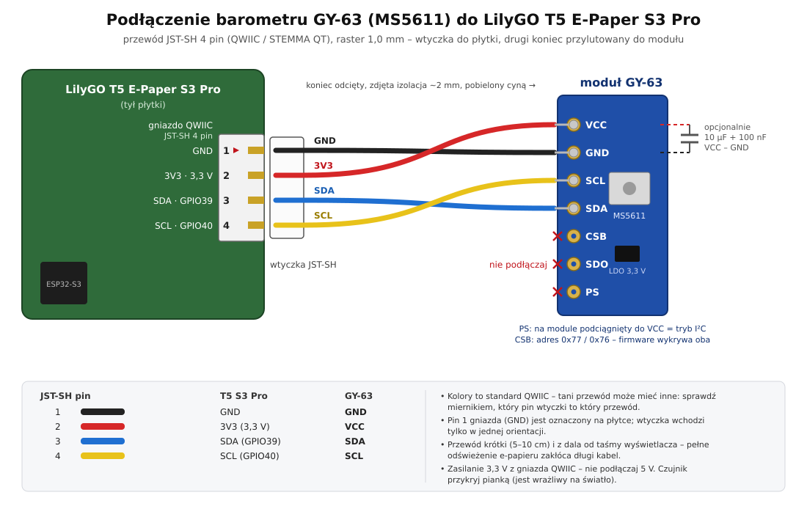
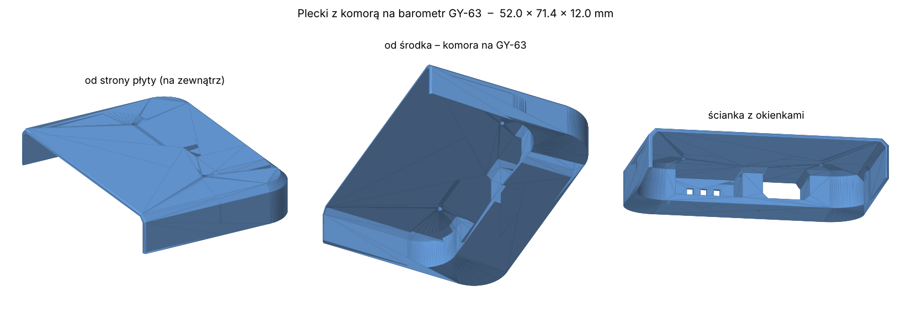

# ParaNav – komputer lotu dla motoparalotni

🇬🇧 [English version](README.md)

Firmware dla **LilyGO T5 E-Paper S3 Pro** (ESP32-S3, e-papier 4,7″ 960×540, GPS MIA-M10Q/L76K) z dodatkowym barometrem **MS5611** na złączu QWIIC. Ekran w poziomie, dane ładowane z karty microSD.

> ⚠️ Projekt eksperymentalny. Dane stref i obliczenia **nie są certyfikowane** – to pomoc, nie podstawa nawigacji. Zawsze sprawdzaj AIP/AUP przed lotem.

## Co to jest i co potrafi

ParaNav to komputer lotu do motoparalotni, zbudowany na gotowej płytce z dużym ekranem e-papier (czytelnym w pełnym słońcu, prawie bez poboru prądu, gdy obraz stoi). Zastępuje w kokpicie wariometr, nawigację GPS, kalkulator paliwa i ostrzegacz stref – wszystko na jednym ekranie, obsługiwane dwoma przyciskami (w rękawicach) albo dotykiem.

**W locie pokazuje:**
* **wysokość i wariometr** – z barometru na kablu albo z BlueFlyVario przez Bluetooth (bez barometru: z GPS); wysokość nad startem i nad terenem, średnie wznoszenie, zysk w kominie,
* **wiatr** – wyliczany sam z kilku zakrętów, bez żadnych czujników,
* **paliwo** – ile zostało czasu lotu, ile paliwa potrzeba na powrót pod wiatr z rezerwą i alarm **WRACAJ**, gdy przestaje wystarczać,
* **powrót i dolot** – kierunek i odległość do startu (Go Home), doskonałość, czy dolecisz do startu bez silnika,
* **nawigację** – do startu, punktu, najbliższego lądowiska albo po trasie z punktami przełączanymi automatycznie,
* **strefy przestrzeni powietrznej** – mapę stref, najbliższą strefę, czas do wlotu, profil pionowy na kursie i alarmy; aktywność stref czasowych z planu AUP,
* **wyjście ze strefy** – gdy przypadkiem wlecisz w aktywną strefę, jednym przyciskiem dostajesz najszybszą drogę na zewnątrz (w poziomie, w górę albo w dół),
* **mapę topograficzną** (ekran TOPO) – lasy, woda, zabudowa, linie energetyczne, wiatraki, maszty, lotniska,
* **innych pilotów (FANET)** – radio 868 MHz na płytce: widzisz paralotniarzy z FANET-em i ostrzeżenia o zbliżeniu, a oni widzą Ciebie.

**Przed lotem i po locie:**
* **trasy planujesz w telefonie** (aplikacja na Androida, mapa OpenTopoMap ze strefami) i wysyłasz przez Bluetooth – ParaNav od razu sprawdza, czy trasa nie przecina stref,
* **strefy, punkty i mapy** wgrywasz z telefonu, czytnikiem kart albo kablem USB (karta jako dysk w komputerze),
* **zapis lotu** IGC i GPX zaczyna się i kończy sam; po lądowaniu – podsumowanie lotu,
* **ładowanie** – po podłączeniu USB urządzenie pyta: nawigacja, ładowanie czy pliki.

**Sprzęt:** LilyGO T5 E-Paper S3 Pro (ESP32-S3, ekran 4,7″ 960×540, GPS, radio LoRa, bateria) + barometr MS5611 za kilkanaście złotych albo BlueFlyVario. Interfejs po polsku lub angielsku, pomoc wbudowana w menu.

## Funkcje – szczegóły (wersja 0.5.8)

| Obszar | Co działa |
|---|---|
| Wysokość | baro (QNH, auto-kalibracja z GPS lub mapy terenu), nad startem, nad terenem (SRTM) |
| Wariometr | filtr Kalmana ~90 Hz, średnia 30 s, wykrywanie krążenia i zysku w kominie (tylko wizualnie – brak brzęczyka) |
| Wiatr | z dopasowania okręgu do wektorów prędkości GPS podczas zakrętów (≥200° w ciągu 90 s) |
| Doskonałość | zmierzona (GS / opadanie) przy locie ślizgowym, zasięg ślizgu z biegunowej + wiatr, „dolecisz do startu” |
| Paliwo | zapas czasu, paliwo na powrót (z wiatrem) + rezerwa, alarm WRACAJ, licznik zatrzymywany przy wyłączonym silniku |
| Strefy | OpenAir z SD, test w poziomie i pionie, przewidywany czas wlotu, plik aktywacji AUP, profil pionowy |
| Wyjście ze strefy | alarm W STREFIE z przyciskami **WYPROWADŹ ZE STREFY / IGNORUJ**; ekran WYJŚCIE z najszybszą drogą na zewnątrz (poziom / w górę / w dół) |
| Kontrola trasy | po wybraniu trasy (w urządzeniu lub z telefonu) lista stref, które przecina; ostrzeżenie także w aplikacji przed wysłaniem |
| Nawigacja | Go Home, punkt z listy, najbliższe lądowisko, wiele tras (.cup) z listą „Wybierz trasę”, trasa narysowana na MAPIE i TOPO, auto-przełączanie punktów, ETE/ETA, wymagana L/D |
| Zapis lotu | IGC + GPX w `/logs`, automatyczny start/stop (wykrywanie startu i lądowania), podsumowanie lotu |
| Mapa TOPO | czarno-biała mapa topograficzna z OpenStreetMap (woda, las, zabudowa, linie energetyczne, wiatraki, maszty, lotniska, drogi), północ u góry, z10–z14 |
| FANET | radio LoRa 868 MHz na płytce: nadawanie pozycji (jako paralotnia), inni piloci na MAPIE, TOPO i ekranie RUCH, ostrzeżenia o zbliżeniu, widoczność w OGN |
| Język | polski / angielski – Menu → Ekran i mapa → Język / Language (zapisywane w `config.ini`: `lang=pl` / `lang=en`) |
| Wgrywanie | karta SD w czytniku, **tryb USB** (karta jako dysk w komputerze), telefon przez Bluetooth (strefy, punkty, trasy) |
| Planowanie tras | w aplikacji na Androida na mapie OpenTopoMap ze strefami i punktami, wysyłane do ParaNav jako aktywna trasa |
| System | bateria (BQ27220), stan GPS, karta SD, FANET, wolna pamięć |

## Sprzęt

### Podłączenie MS5611
Złącze QWIIC (JST-SH 4 pin): **czarny = GND, czerwony = 3V3, niebieski = SDA (GPIO39), żółty = SCL (GPIO40)**.
Moduł GY-63: VCC→3V3, GND→GND, SCL→SCL, SDA→SDA, PS zostaw (na module podciągnięty do VCC = tryb I²C).
Adres 0x77 (CSB=0) lub 0x76 – oba są wykrywane automatycznie.

Wskazówki montażu: czujnik jest **wrażliwy na światło** – przykryj go kawałkiem gąbki/pianki, nie wystawiaj na strumień powietrza ze śmigła, a obudowa powinna mieć mały otwór wyrównujący ciśnienie.



#### Przewód JST-SH przylutowany do GY-63 – krok po kroku
Potrzebny jest przewód **JST-SH 4 pin, raster 1,0 mm** (sprzedawany jako QWIIC / STEMMA QT) – z wtyczką z jednej strony albo dwustronny, przecięty na pół. Wystarczy 5–10 cm.

1. **Sprawdź kolory miernikiem.** Standard QWIIC: pin 1 = czarny GND, pin 2 = czerwony 3V3, pin 3 = niebieski SDA, pin 4 = żółty SCL. Tanie przewody bywają inaczej kolorowe – liczy się pin we wtyczce, nie kolor. Pin 1 gniazda jest oznaczony na płytce.
2. **Przygotuj koniec:** odetnij, zdejmij ok. 2 mm izolacji z każdej żyły, skręć i pobiel cyną. Załóż na przewód kawałki koszulki termokurczliwej.
3. **Przylutuj do padów GY-63:**

   | JST-SH | kolor | T5 S3 Pro | GY-63 |
   |---|---|---|---|
   | 1 | czarny | GND | **GND** |
   | 2 | czerwony | 3V3 | **VCC** |
   | 3 | niebieski | SDA (GPIO39) | **SDA** |
   | 4 | żółty | SCL (GPIO40) | **SCL** |

   **CSB, SDO i PS zostaw niepodłączone.** PS jest na module podciągnięty do VCC (tryb I²C), CSB wybiera adres 0x77/0x76 – firmware sprawdza oba. Kolejność padów bywa różna w różnych partiach modułów: kieruj się opisem na płytce, nie pozycją na rysunku.
4. **Opcjonalnie** przylutuj kondensatory 10 µF i 100 nF między VCC a GND, jak najbliżej czujnika – zmniejszają zakłócenia od pełnego odświeżenia e-papieru.
5. **Zabezpiecz:** obkurcz koszulki, a przewód przy module unieruchom kroplą kleju na gorąco (odciążenie lutów od drgań silnika).
6. **Podłącz wtyczkę** do gniazda QWIIC i włącz urządzenie. Na ekranie startowym powinno pojawić się `[OK] Barometr na kablu MS5611 (adres 0x77)` (albo 0x76), a na ekranie SYSTEM – „Barometr: kabel …” i adres 77/76 na liście I²C. Czujnik można też podłączyć przy włączonym urządzeniu – jest sprawdzany co 10 s.

Zasilanie to **3,3 V z gniazda QWIIC – nigdy 5 V**. Przewód prowadź krótko i z dala od taśmy wyświetlacza.

### Plecki z komorą na barometr (wydruk 3D)
Plik do druku: [`hardware/Lilygo_T5_cover_for_baro.stl`](hardware/Lilygo_T5_cover_for_baro.stl) – „plecki” do LilyGO T5 E-Paper S3 Pro, dopasowane do modułu **GY-63**.



* wymiary ok. **52 × 71,4 × 12 mm**, płyta 1 mm,
* w środku **komora na moduł GY-63**; w bocznej ściance komory są **trzy małe okienka** – czujnik mierzy ciśnienie otoczenia, więc nie zaklejaj ich – oraz większy prostokątny otwór,
* w płycie dwa otwory Ø 1,5 mm (rozstaw ok. 41 mm).

Wskazówki do druku: najłatwiej drukować **płytą do stołu** (model trzeba w slicerze obrócić o 180°); sprawdź w podglądzie slicera, czy wewnętrzne półki komory nie potrzebują podpór. PETG/ASA zniosą słońce w kokpicie lepiej niż PLA. Moduł w komorze przykryj kawałkiem cienkiej pianki (światło zakłóca MS5611), nie zasłaniając okienek.

### Barometr: kabel, BlueFly albo bez
Jeden firmware obsługuje automatycznie trzy przypadki – źródło wybierane jest na bieżąco:
1. **MS5611 na kablu QWIIC** – jeśli odpowiada (sprawdzany co 10 s, można go podłączyć po włączeniu),
2. **BlueFlyVario v25 przez Bluetooth LE** – urządzenie samo wyszukuje „BlueFly…” (usługa Microchip Transparent UART), łączy się i wznawia połączenie po zerwaniu. Obsługiwane formaty wyjścia BlueFly: `PRS`/`_PRS` (domyślny), `LK8EX1`, `LXWP0`, `$XCTOD` (bateria). Pozycja GPS z BlueFly jest ignorowana – używany jest wewnętrzny GPS,
3. **bez barometru** – wysokość i vario z GPS (mniej dokładne, vario opóźnione o kilka sekund).

Zmiana źródła restartuje filtr vario (bez fałszywego skoku), a utrata barometru w locie daje alarm BRAK BAROMETRU. Bluetooth można wyłączyć w Menu → System (oszczędza baterię). Uwaga: BlueFly połączony z ParaNav nie połączy się w tym czasie z telefonem.

**Czujnik na kablu a pełne odświeżenie ekranu (0.5.2):** zasilanie wysokiego napięcia e-papieru zakłóca MS5611 na kablu w czasie pełnego odświeżenia (skok wysokości ok. 2 m, ±0,5 m/s na vario). Na czas odświeżenia i 1 s po nim vario pomija odczyty z kabla i liczy dalej z ostatniego wznoszenia; pojedyncze odczyty odbiegające od prognozy o ponad 1,5 m też są odrzucane (skok trwający 0,3 s jest uznawany za prawdziwy). Ekran SYSTEM pokazuje przy ciśnieniu `F a/b`: przeczekane odświeżenia / odrzucone odczyty. Sprzętowo pomaga 10 µF + 100 nF między VCC a GND przy czujniku i krótki kabel z dala od taśmy wyświetlacza.

### Przyciski
Na schemacie IO48 to linia wyświetlacza, a przycisk użytkownika **S3 jest podłączony przez ekspander PCA9535 (IO1_2)**. Drugim przyciskiem jest **BOOT (GPIO0)**.

| | Krótko | Długo (>0,7 s) |
|---|---|---|
| **KLAWISZ (S3)** | następny ekran / w menu: dalej / w edycji: + | otwórz menu / wybierz / zapisz |
| **BOOT** | poprzedni ekran / w menu: wstecz / w edycji: − | **Go Home** (cel = start, ekran NAWIGACJA) / wyjdź z menu |
| dowolny | potwierdza aktywny alarm | |
| **oba naraz** | krótko (<1 s) = **podświetlenie wł./wył.** | 3 s = **wyłącz** (działa też w menu) |

**Podświetlenie:** naciśnij krótko oba przyciski jednocześnie (albo Menu → Ekran i mapa → Podświetlenie). Gdy świeci, na pasku stanu jest czarny kwadrat ze słoneczkiem – w pełnym słońcu od razu widać, że niepotrzebnie zużywa baterię. Jasność i automatyczne wyłączanie po N minutach ustawisz w tym samym menu. Przycisku PWR nie da się do tego użyć: jest podłączony tylko do układu ładowania (wejście QON układu BQ25896), a nie do procesora, więc program nie widzi jego naciśnięć.

**Włączanie / wyłączanie:** włącza przycisk PWR na płytce albo podłączenie USB. Wyłączanie: **przytrzymaj oba przyciski (KLAWISZ + BOOT) przez 3 s** (po 1 s pojawia się napis „WYŁĄCZANIE…”, puszczenie anuluje) albo Menu → *Wyłącz urządzenie* → *TAK*. Lot zostaje zapisany i zamknięty, a na ekranie zostaje napis „WYŁĄCZONY”. Układ ładowania BQ25896 odcina wtedy baterię. **Przy podłączonym USB wyłączenie nie działa**, bo tak działa ten układ, a nie firmware.

Dotyk (gdy masz gołe palce): pasek u góry = menu, lewa krawędź = poprzedni ekran, prawa = następny, na MAPIE środek = zmiana skali, na NAWIGACJI = zmiana celu, na PALIWIE = przyciski ±0,5 l / pełny bak / silnik. W menu: dotknij pozycji, aby ją wybrać; długie listy mają po prawej duże przyciski **▲ / ▼** (strona w górę / w dół).

**Odświeżanie menu:** menu, pomoc i podsumowanie lotu są statyczne – przerysowują się tylko po naciśnięciu przycisku lub dotknięciu (bez odświeżania co sekundę i bez pełnego odświeżania co minutę). Pełne odświeżenie (mignięcie) jest przy otwarciu i zamknięciu menu oraz po każdych 20 ruchach w menu, więc nie zbierają się ślady poprzednich obrazów.

### Zasilanie USB: nawigacja, ładowanie albo pliki
Po pojawieniu się zasilania USB ParaNav pyta, co robić (jak kamery sportowe): **NAWIGACJA** (normalna praca, np. z powerbankiem w locie), **ŁADOWANIE** (statyczny ekran baterii: nawigacja wstrzymana, FANET i BlueFly wyłączone, ekran odświeża się tylko przy zmianie procentów) albo **PLIKI** (tryb USB – tylko gdy po drugiej stronie kabla jest komputer). Dotknij przycisku albo KLAWISZ krótko = następny / długo = wybierz.

* Brak odpowiedzi przez 15 s: **ładowanie**, jeśli urządzenie włączyło się od podłączenia USB; **nawigacja**, jeśli już pracowało.
* **W locie pytanie się nie pojawia** – podłączony w locie powerbank po prostu zasila urządzenie. Po restarcie z powodu błędu (watchdog, panic, brownout) urządzenie od razu wraca do nawigacji.
* Wyjście z ładowania: dotknij ekranu, przytrzymaj KLAWISZ albo **odłącz USB** → rusza nawigacja. Ręcznie: Menu → System → *Tryb ładowania*.

Podglądy: `docs/screens/pl/V_usb_pytanie.png`, `W_ladowanie.png`.

### Wyjście ze strefy i kontrola trasy
Gdy wlecisz w aktywną strefę (te same strefy, które dają alarm W STREFIE – klasy z listy ignorowanych i strefy nieaktywne wg AUP się nie liczą), alarm ma dwa przyciski:
* **WYPROWADŹ ZE STREFY** (KLAWISZ krótko lub lewy przycisk) – ekran **WYJŚCIE** z najszybszą drogą na zewnątrz, niezależnie od celu, trasy i Go Home,
* **IGNORUJ** (BOOT krótko lub prawy przycisk) – alarm wraca po 2 min, jeśli nadal jesteś w strefie.

Porównywane są trzy drogi, wybierana najszybsza:
* **w poziomie** – kierunki co 5°; dla każdego odległość do wolnej przestrzeni (przez sąsiadujące strefy, + 150 m zapasu), czas = zakręt (12°/s) + lot z prędkością max(GS, przelotowa),
* **w górę** – ponad pułap wszystkich stref nad Tobą (także strefy leżącej wyżej) + 30 m, ze wznoszeniem z Menu → Alarmy (domyślnie 1,5 m/s),
* **w dół** – pod podstawę − 30 m, z opadaniem z Menu → Alarmy (domyślnie 2 m/s); niedostępne, gdy strefa zaczyna się od ziemi albo trzeba by zejść niżej niż 60 m nad teren.

Ekran: strzałka względem Twojego kursu (albo duża strzałka WZNOŚ SIĘ / ZNIŻAJ SIĘ z wysokością docelową), nazwa strefy i czasy wszystkich trzech możliwości. Plan liczony jest co sekundę; 10 s po wyjściu ekran sam się zamyka (ręcznie: przytrzymaj KLAWISZ). Bez alarmu: Menu → Nawigacja → *Wyprowadź ze strefy*.

**Kontrola trasy:** po wybraniu trasy w Menu → Nawigacja → Wybierz trasę albo po aktywacji z telefonu ParaNav sprawdza, które strefy trasa przecina (próbka co 100 m), z teren pod trasą i dzisiejszym planem aktywności. Kolizja = strefa nie-nieaktywna z podstawą poniżej wysokości z Menu → Alarmy → *Kontrola trasy: lot do* (domyślnie 1000 m nad terenem). Lista pokazuje się na ekranie; aplikacja dostaje liczbę kolizji i ją wyświetla. Aplikacja sama sprawdza trasę już przed wysłaniem (na strefach wczytanych na mapę, bez terenu i planu AUP – ostrożniej). Ponownie: Menu → Nawigacja → *Sprawdź trasę – strefy*.

## Pomoc w urządzeniu
Menu → **Pomoc**: przyciski i dotyk, pasek stanu, opis każdego ekranu, alarmy, pliki na karcie SD, automatyczny start/lądowanie/zapis. Treść jest w `lib/navcore/src/ui/help.cpp` – łatwo ją poprawić; `tools/preview/layout_check.sh` sprawdza, czy każda strona mieści się na ekranie i czy font ma wszystkie znaki.

## Ekrany

`LOT → MAPA → TOPO → RUCH → NAWIGACJA → TERMIKA → STREFY → PALIWO → SYSTEM` (podglądy PNG w `docs/screens/pl/`; TOPO na podglądzie pokazuje fikcyjną mapę testową).

Wygląd (0.5.3): dane są pogrupowane w „karty” z zaokrąglonymi rogami (ramka 2 px, odstępy 6 px), pasek stanu jest czarny jak tytuł menu, ostrzeżenia to zaokrąglone czarne paski, przyciski dotykowe mają mały cień, a pasek vario to zaokrąglona skala z grubą kreską zera. Wszystko jest czysto czarno-białe – szarości nie przetrwają szybkiego odświeżania (DU). Funkcje rysujące: `Canvas::roundRect / fillRoundRect / invertRoundRect`, `card()` i `pill()` w `screens.cpp`.

### Strefy na mapie
Wnętrza stref są kreskowane, a nie szare. Szybkie odświeżanie e-papieru (co 1 s) obsługuje tylko czerń i biel, więc szarość „pływałaby” między odświeżeniami.

* **gęsta kratka** – strefy zakazane, ograniczone i niebezpieczne (P, R, Q, EPP/EPR/EPD),
* **ukośne linie co 10 px** – CTR oraz TRA/TSA (EPTR/EPTS),
* **rzadkie ukośne linie** – pozostałe (TMA, ATZ, klasy C/D...).

Kreskowane są tylko strefy aktywne i istotne na Twojej wysokości: jesteś w ich zakresie pionowym albo bliżej niż 2× bufor pionowy, min. 150 m. Strefy wysoko nad Tobą lub pod Tobą mają sam kontur, a nieaktywne – kontur przerywany.

## Trasy: planowanie i wybór

* **Planowanie – aplikacja na Androida** → „Zaplanuj nową trasę na mapie” / „Moje trasy”. Mapa OpenTopoMap (topograficzna), na niej strefy i punkty z plików wysłanych do ParaNav (albo dodanych w menu planowania). Dotknięcie mapy = nowy punkt (dotknięcie znanego punktu bierze jego nazwę i wysokość), dotknięcie punktu = nazwa / lądowisko / wstaw przed / usuń, przytrzymanie i przeciągnięcie = przesunięcie, ↶ = cofnij, ⤢ = cała trasa. Pod mapą odcinki z odległością i kursem, długość i czas przy Twojej prędkości przelotowej. Trasy zapisują się w telefonie same; można je eksportować i importować jako `.cup`.
* **Wysyłanie:** „Wyślij do ParaNav” dodaje trasę obok istniejących (opcja: usuń pozostałe) i może od razu ustawić ją jako **aktywną** (firmware 0.5+).
* **W ParaNav:** Menu → Nawigacja → **Wybierz trasę** – wszystkie trasy z karty z liczbą punktów i długością (● = aktywna); wybór jest zapamiętany w `config.ini` (`routeFile`). Aktywna trasa jest narysowana na MAPIE i TOPO: linia z numerowanymi kółkami, kwadrat = lądowisko, czarny = punkt, do którego lecisz.
* **Wysokość:** punkty zaplanowane na mapie nie mają wysokości w pliku `.cup`; ParaNav bierze ją z mapy terenu (`/terrain`). Bez mapy terenu dolot ślizgiem do takiego punktu pokazuje „––” zamiast błędnej wartości.

Kafelki mapy: © OpenStreetMap contributors, SRTM | styl mapy © OpenTopoMap (CC-BY-SA). Aplikacja pobiera tylko to, co widać na ekranie, i zapisuje w pamięci telefonu (oglądane wcześniej okolice działają bez internetu); pobieranie całych obszarów na zapas jest niedozwolone przez serwer map.

## Wysyłanie plików z telefonu (Android)
Aplikacja w katalogu `android/` (instrukcja budowania: `android/README.pl.md`) wysyła przez Bluetooth strefy (OpenAir), aktywacje na dziś, punkty i trasę (.cup) – bez wyjmowania karty SD. ParaNav sprawdza każdy plik przed zapisaniem i od razu go wczytuje; w czasie odbioru na dole ekranu jest pasek postępu, a na pasku stanu „TEL”. Włączanie/wyłączanie: Menu → System → Telefon (Bluetooth).

## Karta SD (FAT32)

```
/config.ini                 ustawienia (tworzone/aktualizowane przez urządzenie)
/airspace/*.txt             strefy w formacie OpenAir (wczytywane są wszystkie pliki .txt)
/airspace/activations.txt   aktywacje stref na dziś (format poniżej)
/waypoints/*.cup            punkty (SeeYou .cup); styl 2–5 = lądowisko
/route/*.cup                trasa – kolejność punktów w pliku = kolejność trasy
/terrain/N52E021.hgt ...    mapa terenu SRTM (.hgt, 3″ lub 1″)
/maps/<obszar>/info.txt     mapa podkładowa dla ekranu TOPO (+ z10.pak … z14.pak)
/logs/                      zapisane loty .igc + .gpx
```
Przykładowe (fikcyjne!) pliki są w katalogu `sd_card/`.

### Skąd brać dane
* **Strefy (OpenAir)**: [openAIP](https://www.openaip.net) – eksport dla Polski w formacie OpenAir; albo plik Ryszarda Lewandowskiego z lotnik.org (link na [soaringweb.org/SUA/PL](https://soaringweb.org/SUA/PL)). Aktualizuj co cykl AIRAC (28 dni).
* **Aktywacje (AUP/UUP)**: strefy TRA/TSA/EPR/EPD/MRT są aktywowane dziennie. Na razie przepisujesz je do `activations.txt` (np. z aplikacji „AUP w Polsce” lub serwisu PANSA). Bez tego pliku takie strefy mają status „AKT.?” i są traktowane jak aktywne (bezpieczniej).
  ```
  date=2026-11-16
  EPTR12 0800-1500
  EPTS05 0900-1100 1300-1600
  ```
  Czas w **UTC**; nazwa dopasowuje się do początku nazwy strefy (`EPTR12` pasuje do „EPTR12 KRZESINY”, ale nie do „EPTR121”).
* **Teren**: kafle SRTM `.hgt` w katalogu `/terrain` (szczegóły w sekcji „Mapa terenu” niżej).
* **Punkty**: dowolny edytor .cup (SeeYou, XCSoar, WeGlide).

## Mapa terenu (.hgt)

Teren daje: wysokość **nad terenem**, automatyczne QNH, profil pionowy na ekranie STREFY i zasięg ślizgu względem ziemi. Bez niego te pola pokazują „––”, a reszta działa.

**Skąd:**
1. **viewfinderpanoramas.org** (polecane – SRTM z uzupełnionymi dziurami): strona [dem3.html](https://viewfinderpanoramas.org/dem3.html) → mapa pokrycia 3″ → kliknij arkusze nad Polską. Arkusze mapy świata 1:1 mln nazywają się **M33, M34** (48–52°N) i **N33, N34** (52–56°N), wschodni skraj Polski jest w **M35/N35**. Każda paczka ZIP to kilkadziesiąt kafli.
2. **NASA Earthdata**, zbiór SRTMGL3 (wymaga darmowego konta): pliki `N52E021.SRTMGL3.hgt.zip` – po rozpakowaniu `N52E021.hgt`.

**Dokąd:** do katalogu **`/terrain`** na karcie SD. Kafle mogą leżeć bezpośrednio tam albo w podkatalogach, np. tak, jak rozpakuje się ZIP: `/terrain/M34/N52E021.hgt`. Wielkość liter nie ma znaczenia.

**Które:** nazwa kafla to jego południowo-zachodni róg, np. `N52E021.hgt` = 52–53°N, 21–22°E. Cała Polska to N49–N54 × E014–E024 (~60 kafli z lądem, ok. 170 MB w 3″). Wystarczą kafle wokół miejsc, w których latasz. Obsługiwane są 3″ (2,9 MB/kafel) i 1″ (26 MB/kafel; dokładniejsze, ale wolniejsze na karcie).

**Sprawdzenie:** ekran SYSTEM → „Teren / mapa” (pierwsza liczba = znalezione kafle terenu) i „Teren pod Tobą” (wysokość terenu w Twoim miejscu, po złapaniu GPS).

## Mapy podkładowe (ekran TOPO)

Ekran **TOPO** (po MAPIE) pokazuje mapę topograficzną przygotowaną specjalnie dla e-papieru: czarno-białą, z grubymi znakami tego, co groźne dla pilota.

| Znak | Co to |
|---|---|
| poziome kreski, ciągły brzeg | woda, morze |
| kropki | las |
| kratka | zabudowa (osiedla, przemysł) |
| linia z poprzecznymi kreskami i kropkami | linia wysokiego napięcia (cienka bez kropek – średnie napięcie, od z12) |
| trójnóg w kółku | wiatrak (od z13 z wysokością, jeśli jest w OSM) |
| daszek z kropką | maszt, wieża, komin |
| kółko z poziomą kreską | lotnisko / lądowisko (`aeroway=aerodrome/airstrip`), od z12 pasy startowe |
| czarne linie | drogi (grubość = ranga) |
| podwójna linia | rzeka; czarno-biała linia – kolej |

Na mapę nakładane są: Twoja pozycja i kurs, ślad, START, linia do celu, punkty i lądowiska z `.cup` oraz **tylko kontury** stref (szczegóły – ekran STREFY i alarmy). W rogach: wysokość/AGL, prędkość/kurs, vario/wiatr, najbliższa strefa. Dotyk górnej połowy mapy – przybliż, dolnej – oddal (z10 ≈ 90 km szerokości ekranu, z14 ≈ 6 km). Mapa przesuwa się skokami (gdy odlecisz od środka o ok. 1/3 ekranu), żeby e-papier nie przerysowywał wszystkiego co sekundę.

> Mapa z OSM jest pomocą orientacyjną, **nie mapą lotniczą** – linie energetyczne i przeszkody mogą być niekompletne.

### 1. Przygotowanie mapy

Dane: [Geofabrik](https://download.geofabrik.de/europe/poland.html) (OpenStreetMap, licencja ODbL – pobieranie do użytku offline dozwolone). Program: `tools/topo/make_tiles.py`.

**Sposób A – na GitHubie, bez instalowania czegokolwiek (polecany):**
1. Projekt w Twoim repozytorium na GitHubie (to samo, co do budowania APK).
2. **Actions → „Build map” → Run workflow.** Domyślnie: Gdańsk, promień 100 km, poziomy 10–14, pliki pomorskie + kujawsko-pomorskie + warmińsko-mazurskie + obwód kaliningradzki (żeby linia brzegowa Zalewu i Mierzei była ciągła).
3. Po ok. 10–30 min: otwórz zakończone uruchomienie → pobierz artefakt **mapa-gdansk** (zip) → rozpakuj. W środku katalog `maps` i podglądy `preview_*.png`.

Inny obszar: zmień nazwę, środek, promień i listę plików Geofabrik (muszą razem pokryć cały okrąg – np. dla Warszawy `europe/poland/mazowieckie`). Cała Polska: `europe/poland` (duży plik, długo).

**Sposób B – na własnym komputerze** (Python 3.9+):
```
pip install -r tools/topo/requirements.txt
python3 tools/topo/make_tiles.py --pbf pomorskie-latest.osm.pbf --pbf kujawsko-pomorskie-latest.osm.pbf \
   --pbf warminsko-mazurskie-latest.osm.pbf --pbf kaliningrad-latest.osm.pbf \
   --name gdansk --title "Gdańsk 100 km" --center 54.35,18.65 --radius-km 100 --zooms 10-14 --out out --preview
```

Rozmiar: Gdańsk 100 km, z10–z14 – szacunkowo 20–60 MB (morze i jednolite lasy zajmują prawie nic – identyczne kafelki są zapisane raz).

### 2. Wgrywanie na kartę

* **Czytnik kart:** skopiuj katalog `maps` do katalogu głównego karty.
* **Tryb USB (bez wyjmowania karty):** Menu → System → **Tryb USB – karta SD jako dysk**, podłącz USB-C do komputera. Karta pojawi się jako dysk „ParaNav”. Skopiuj `maps`, potem **wysuń dysk w komputerze** – ParaNav sam wróci do pracy i wczyta wszystko od nowa (albo KLAWISZ/BOOT długo). Działa też dla stref, punktów, terenu i lotów (`/logs` – zgrywanie IGC). Tryb USB jest niedostępny w locie; zapis lotu zostaje zamknięty. Po włączeniu trybu urządzenie na chwilę rozłącza się z komputerem i łączy ponownie (0.5.6) – dzięki temu system widzi włożoną „kartę” i pokazuje dysk; w tym czasie FANET i BlueFly są wyłączone.

Kilka obszarów na karcie (np. `maps/gdansk`, `maps/wyjazd`) – urządzenie samo wybiera ten, który obejmuje Twoją pozycję. SYSTEM → „Teren / mapa” pokazuje kafle terenu i nazwę aktywnej mapy.

## FANET – inni piloci (LoRa 868 MHz)

Wbudowany moduł SX1262 pracuje w otwartym protokole **FANET** (868,2 MHz, LoRa SF7/250 kHz, [specyfikacja](https://github.com/3s1d/fanet-stm32/blob/master/Src/fanet/radio/protocol.txt)) – tym samym, którego używają Skytraxx, XC Tracer, Naviter (FANET+), Burnair, Leaf, GXAirCom, SoftRF. **FLARM nie jest obsługiwany** (zamknięty, szyfrowany protokół) – samoloty i szybowce z samym FLARM nie widzą ParaNav, a ParaNav nie widzi ich.

* **Nadawanie:** pozycja, wysokość GPS, prędkość, vario i kurs co 5 s (w powietrzu pakiet „tracking”, typ statku *paralotnia*; na ziemi „ground tracking”), nazwa pilota co 4 min – wpisz ją w `config.ini` jako `pilot=Imię Nazwisko` (wysyłana bez polskich ogonków; przy domyślnym „Pilot” nazwa nie jest wysyłana). Adres: `FD` + losowy 16-bitowy numer zapisany w `config.ini` (`fanetId`) – widoczny na ekranie SYSTEM i RUCH.
* **Widoczny online** (domyślnie TAK): bit „online tracking” – stacje [OGN](https://www.glidernet.org) mogą pokazać Twoją pozycję w internecie. Menu → FANET → Widoczny online.
* **Wyświetlanie:** MAPA i TOPO – strzałki z różnicą wysokości; ekran **RUCH** – lista i radar (kursem do góry), dotknięcie pilota ustawia go jako cel nawigacji; pasek stanu **FN n**.
* **Ostrzeżenia** (tylko w locie): prognoza najbliższego zbliżenia na 60 s przy stałych kursach i prędkościach. *Uwaga* (ramka RUCH w prawym górnym rogu dowolnego ekranu): bliżej niż próg odległości (domyślnie 300 m) i wysokości (100 m) albo prognoza takiego zbliżenia w ciągu 45 s. *Alarm* (pasek RUCH! godz. N): połowa progów albo w ciągu 20 s. Progi i wyłączenie: Menu → FANET.
* **Antena wewnętrzna** – zasięg zależy od tego, gdzie leży urządzenie (metal kosza, ciało pilota). Sprawdź na ziemi z kolegą albo na glidernet.org, czy Twoja pozycja dociera.

> FANET to pomoc w obserwacji, nie system antykolizyjny: pozycje przychodzą co ~5 s, nie każdy ma nadajnik. Patrz w powietrze.

## Budowanie

1. Zainstaluj [PlatformIO](https://platformio.org) (VS Code + rozszerzenie lub `pip install platformio`).
2. `pio run -t upload` w katalogu projektu. Jeśli płytka nie wchodzi w tryb programowania: przytrzymaj BOOT, krótko RST, puść BOOT.
3. Biblioteki LilyGO (epdiy, SensorLib, BQ27220) i RadioLib 6.5 (LoRa) są dołączone w `lib/` – to te same wersje co w repozytorium producenta. NimBLE-Arduino 1.4.3 (Bluetooth) PlatformIO pobierze sam (`lib_deps`).

Alternatywnie arduino-cli (rdzeń esp32 2.0.14): `tools/build_arduino_cli.sh`.

**USB od wersji z mapami:** firmware używa trybu USB-OTG (TinyUSB, `ARDUINO_USB_MODE=0`), bo tylko w nim karta SD może być dyskiem USB. Port szeregowy nadal działa (logi, wgrywanie przez `pio run -t upload`), ale w systemie to inne urządzenie COM niż wcześniej. Jeśli wgrywanie się nie uda (np. program zawiesił się przy starcie): przytrzymaj BOOT, krótko RST, puść BOOT i wgraj ponownie.

### Gotowe pliki (GitHub Releases)
Bez instalowania PlatformIO: w zakładce **Releases** są gotowe pliki każdej wersji – `paranav-<wersja>-firmware.bin` (sam program, adres 0x10000), `paranav-<wersja>-full.bin` (pełny obraz dla czystej płytki, adres 0x0) i `paranav-<wersja>.apk` (aplikacja). Firmware wgrasz z przeglądarki Chrome/Edge przez https://espressif.github.io/esptool-js/ (*Connect* → plik pod adres `0x0` dla `full.bin` → *Program*).

**Nowa wersja:** ustaw ten sam numer w `src/config.h` (`PARANAV_VERSION`) i `android/app/build.gradle` (`versionName`, `versionCode` +1), opcjonalnie opisz zmiany w `docs/releases/v<wersja>.md`, wyślij na `main`, a potem GitHub → **Actions → Release → Run workflow**. Workflow uruchamia testy, buduje firmware i APK i publikuje release `v<wersja>` (gdy taki już istnieje – zatrzymuje się).

### Testy bez sprzętu
* `tools/run_tests.sh` – testy jednostkowe (NMEA, Kalman, wiatr, parser OpenAir, aktywacje, kolizje ze strefami, IGC, .cup, teren, logika lotu, alarmy, przesyłanie plików, dekoder mapy TOPO, kodowanie FANET i ocena zbliżeń).
* `tools/topo/selftest.sh` – cała ścieżka mapy bez internetu: fikcyjny plik OSM → `make_tiles.py` → czytnik kafelków z firmware (każdy kafelek dekodowany i sprawdzany sumą CRC).
* `tools/android_proto_test/run.sh` – test protokołu wysyłania plików: kod aplikacji (`Uploader.java`) rozmawia z kodem firmware (`FileReceiver`), z celowo gubionymi pakietami.
* `tools/android_planner_test/run.sh` – funkcje planowania tras z aplikacji (współrzędne, zapis/odczyt `.cup`, parser OpenAir) i sprawdzenie krzyżowe: plik `.cup` zapisany przez aplikację czyta firmware.
* `tools/preview/layout_check.sh` – renderuje wszystkie ekrany, menu, alarmy i ekran startowy w sytuacjach normalnych, „nic nie działa” i ze skrajnymi wartościami (9999 m, -12.3 m/s, 999 km, długie nazwy stref i punktów...). Zgłasza każdy napis, który wychodzi poza ekran, nachodzi na inny napis albo przecina linię podziału.
* `tools/preview/build.sh` – symuluje lot i renderuje wszystkie ekrany do PNG (`/tmp/preview`), ten sam kod UI co na urządzeniu. `PARANAV_LANG=en` – po angielsku. `layout_check.sh` sprawdza oba języki.

## Restarty i raporty awarii

Każde uruchomienie jest zapisywane w **`/logs/restarts.txt`** (powód restartu, jak długo działało poprzednio, ostatnia czynność, napięcie baterii). Każdy nieoczekiwany restart ma też pełny raport **`/logs/crash-NN.txt`**: powód (błąd programu, watchdog, spadek napięcia, zanik zasilania bez wyłączenia), stan tuż przed restartem (bateria, USB, ekran, lot, FANET, najmniej wolnej pamięci), ok. 12 ostatnich czynności z czasem oraz – przy błędzie programu i watchdogu – ślad stosu do rozkodowania z `firmware.elf`. Raport jest zapisywany od razu po zamontowaniu karty, przed wczytaniem danych, więc awaria podczas wczytywania też jest zgłoszona.

Po **3 awariach z rzędu**, każdej w ciągu 2 minut od startu, ParaNav uruchamia się w **trybie awaryjnym**: Bluetooth (BlueFly, telefon), FANET i mapy TOPO są wtedy wyłączone, żeby urządzenie dało się używać i zgrać raporty (np. w trybie USB). Po 5 minutach normalnej pracy kolejne uruchomienie jest już zwykłe.

## Do sprawdzenia na sprzęcie (pierwsze uruchomienie)
1. **Orientacja** – jeśli obraz jest do góry nogami: Menu → Ekran i mapa → Obróć ekran o 180°.
2. **Dotyk** – dotknięcie lewej / prawej krawędzi powinno zmieniać ekran; jeśli działa odwrotnie albo w złym miejscu, popraw mapowanie w `board.cpp: toScreen()`.
3. **VCOM** – wartość z naklejki na taśmie wyświetlacza (domyślnie 1560 mV jak w firmware LilyGO).
4. **Duchy na e-papierze** – szybkie odświeżanie (DU) co 1 s, pełne co `fullRefreshS` (domyślnie 60 s, 0 = wyłączone).
5. **Barometr** – na ziemi wario powinno pokazywać ±0,1 m/s; QNH kalibruje się samo po złapaniu ≥6 satelitów.

## Ograniczenia / dalsze kroki
* Brak dźwięku wariometru (brak brzęczyka) – przygotowane ustawienie `varioSound`.
* Plik IGC nie ma podpisu G (nie jest „walidowany” jak z certyfikowanego rejestratora). Do XContest zwykle wystarcza, na zawody z wymogiem walidacji – nie.
* Wiatr wymaga zakrętów; w locie prostym pokazywana jest ostatnia wartość z wiekiem pomiaru.
* Mapa TOPO: tylko północ u góry; mapy przez Wi-Fi z telefonu – następny etap (dziś: czytnik kart lub tryb USB).

## Struktura kodu
```
src/            sprzęt: main.cpp (zadania, logika 1 Hz, menu), board.cpp (e-papier, przyciski, dotyk, bateria, SD),
                ms5611.cpp, gps.cpp, fanet_radio.cpp (LoRa SX1262), usb_disk.cpp, config.h (piny)
lib/navcore/    przenośny rdzeń (kompiluje się też na PC): geo, nmea, vario (Kalman), wind, airspace (OpenAir),
                terrain (HGT), topo (mapa TOPO), fanet (protokół FANET, ruch), waypoints (.cup), logger (IGC/GPX), flight (logika lotu), alerts, settings,
                ui/ (canvas, fonty, ekrany, menu)
test/           testy jednostkowe (host)
tools/          generator fontów, podgląd ekranów, skrypty budowania, topo/ (generator mapy TOPO), docs/ (schematy do README)
sd_card/        przykładowa zawartość karty
hardware/       pliki do druku 3D (plecki z komorą na GY-63)
docs/hardware/  schemat podłączenia GY-63, podgląd wydruku (generowane przez tools/docs/)
```
Licencje: RadioLib – MIT; dane mapy TOPO – © OpenStreetMap contributors, ODbL; epdiy – LGPL-3.0, SensorLib – MIT, fonty DejaVu – licencja Bitstream Vera/DejaVu.
